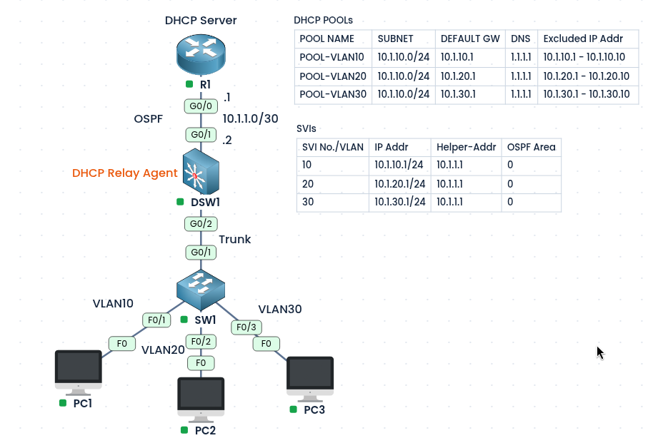
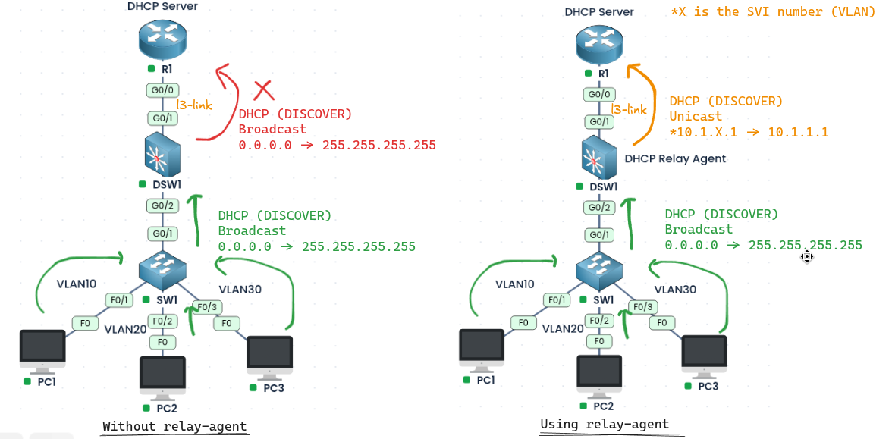
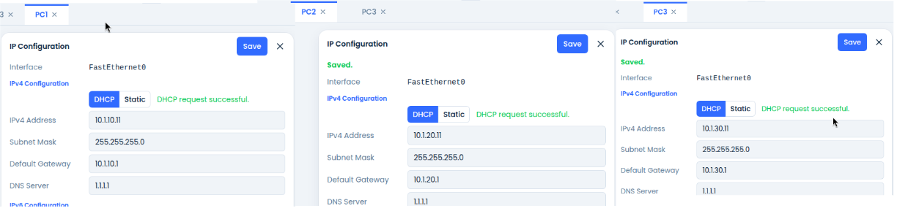
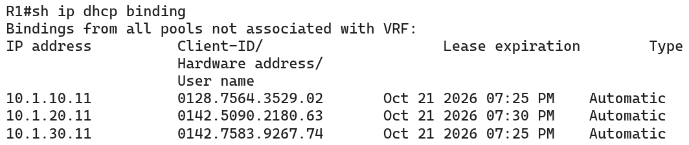

#### Labs built using:
- [PingMyNetwork Sandbox](https://pingmynetwork.com/profile/doer)
---
## Cisco Router as a DHCP Server with Relay Agent

#### 1). Topology Overview
- R1 is the **DHCP server** and DSW1 is the **DHCP relay agent**. SW1 is a Layer 2 switch that connects the PCs to DSW1.
- PC1, PC2, and PC3 are in VLAN 10, 20, and 30. Their default gateways are the DSW1 SVIs (`10.1.10.1`, `10.1.20.1`, `10.1.30.1`).
- R1 and DSW1 run OSPF, and R1 connects to DSW1 over `10.1.1.0/24` (R1 G0/0 is `10.1.1.1`).
* Why a relay agent is needed:
	- A PC asks for an IP address using a **broadcast**, and a routing device do not forward broadcasts.
	- Without help, the request stops at DSW1 and never reaches R1.
	- The relay agent converts the broadcast into a **unicast** packet sent straight to the DHCP server, and passes the reply back to the PC.
	- 
---
#### 2). Configuration
- R1 (DHCP server) has one pool per VLAN. The first 10 addresses of each subnet are excluded so they are never given to PCs (they are kept for gateways and other devices).

| POOL NAME   | SUBNET       | Default Gateway | DNS Server | Excluded IP Address    |
| ----------- | ------------ | --------------- | ---------- | ---------------------- |
| POOL-VLAN10 | 10.1.10.0/24 | 10.1.10.1       | 1.1.1.1    | 10.1.10.1 - 10.1.10.10 |
| POOL-VLAN20 | 10.1.20.0/24 | 10.1.20.1       | 1.1.1.1    | 10.1.20.1 - 10.1.20.10 |
| POOL-VLAN30 | 10.1.30.0/24 | 10.1.30.1       | 1.1.1.1    | 10.1.30.1 - 10.1.30.10 |

- R1 Configuration:
```
ip dhcp excluded-address 10.1.10.1 10.1.10.10
ip dhcp excluded-address 10.1.20.1 10.1.20.10
ip dhcp excluded-address 10.1.30.1 10.1.30.10
ip dhcp pool POOL-VLAN10
 network 10.1.10.0 255.255.255.0
 default-router 10.1.10.1
 dns-server 1.1.1.1
ip dhcp pool POOL-VLAN20
 network 10.1.20.0 255.255.255.0
 default-router 10.1.20.1
 dns-server 1.1.1.1
ip dhcp pool POOL-VLAN30
 network 10.1.30.0 255.255.255.0
 default-router 10.1.30.1
 dns-server 1.1.1.1
```
- DSW1 is the relay agent. `ip helper-address` on each SVI tells it to forward DHCP requests to R1’s G0/0 address (`10.1.1.1`).

| SVI Number/VLAN | IP Address   | Helper-Address IP | OSPF Area |
| --------------- | ------------ | ----------------- | --------- |
| 10              | 10.1.10.1/24 | 10.1.1.1          | 0         |
| 20              | 10.1.20.1/24 | 10.1.1.1          | 0         |
| 30              | 10.1.30.1/24 | 10.1.1.1          | 0         |

- DSW1 Configuration:
```
interface range Vlan10
 ip address 10.1.10.1 255.255.255.0
 ip helper-address 10.1.1.1
interface Vlan20
 ip address 10.1.20.1 255.255.255.0
 ip helper-address 10.1.1.1
interface Vlan30
 ip address 10.1.30.1 255.255.255.0
 ip helper-address 10.1.1.1
```
- **VERY IMPORTANT:** R1 must have a route to the VLAN subnets (`10.1.10.0/24`, `10.1.20.0/24`, `10.1.30.0/24`). OSPF provides this by advertising the SVIs. Without it, R1’s replies cannot get back to DSW1 and the PCs get no address.
```
! R1
router ospf 110
 router-id 1.1.1.1
interface Gi0/0
 ip ospf 110 area 0
 ip ospf network point-to-point
 
! DSW1
router ospf 110
 router-id 11.11.11.11
 passive-interface vlan10
 passive-interface vlan20
 passive-interface vlan30
interface range vlan10,vlan20,vlan30
 ip ospf 110 area 0
interface g0/1
 ip ospf 110 area 0
 ip ospf network point-to-point
```
---
#### 3). Verification
- PC1, PC2, and PC3
- 
- R1
- 