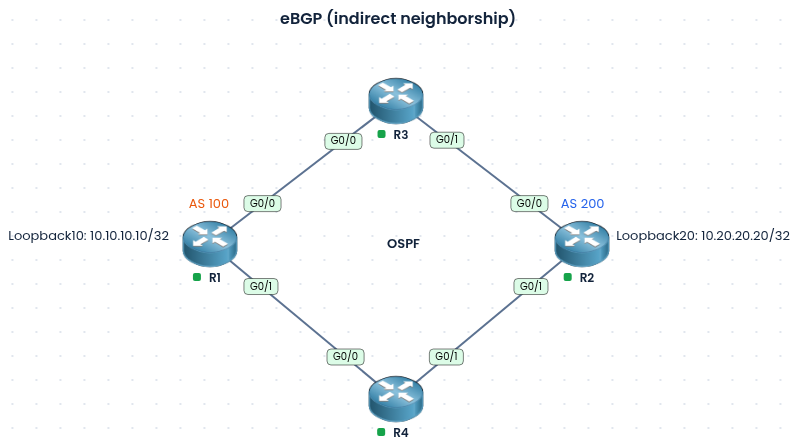

### Labs built using:
* [PingMyNetwork Sandbox](https://pingmynetwork.com/)
---
# eBGP Indirect Neighborship

### 1). Topology Overview
- R1 (AS 100) and R2 (AS 200) are in different autonomous systems and are not directly connected. They reach each other through two redundant paths: R1 > R3 > R2 and R1 > R4 > R2.
- R3 and R4 are transit routers, and all four routers run OSPF.
- OSPF advertises Loopback10 (10.10.10.10/32) on R1 and Loopback20 (10.20.20.20/32) on R2, so each router can reach the other’s loopback.
- An eBGP neighborship is formed between R1 and R2 using the Loopback10 and Loopback20 addresses as the peering endpoints.
- NOTE;
	- By default, eBGP packets have a TTL of 1, so a peering with a non-directly-connected address (like a loopback) fails.
	- So, eBGP multihop is required, multihop raises the TTL so the session can form.
- Advantages of using indirect neighborship:
    * **1). Redundancy:** Two paths (via R3 and R4) mean one link or router failure doesn’t break the eBGP session.
    * **2). Load balancing:** OSPF can use both equal-cost paths to reach the peer loopback.
    * **3). Stable peering:** Loopbacks stay up as long as the router is up.
    * 4). **Simple transit routers:** R3 and R4 only run OSPF, with no BGP needed.
    * 5). **Easy to scale:**
### 2). Configuration
* R1 BGP configuration
```
router bgp 100
 no bgp default ipv4-unicast
 neighbor 10.20.20.20 remote-as 200
 neighbor 10.20.20.20 update-source loopback 10
 
 neighbor 10.20.20.20 ebgp-multihop 2
 
 address-family ipv4
  neighbor 10.20.20.20 activate
```
* R2 BGP configuration
```
router bgp 200
 no bgp default ipv4-unicast
 neighbor 10.10.10.10 remote-as 100
 neighbor 10.10.10.10 update-source loopback 20
 
 neighbor 10.10.10.10 ebgp-multihop 2
 
 address-family ipv4
  neighbor 10.10.10.10 activate
```
### 3). Verification
* R1
```
R1#show bgp ipv4 unicast summary
...
Neighbor      V  AS  MsgRcvd MsgSent TblVer InQ OutQ   Up/Down   State/PfxRcd
10.20.20.20   4 200        6       6      1   0    0   00:3:28        0
```
* R2
```
R2#show bgp ipv4 unicast summary
...
Neighbor      V  AS  MsgRcvd MsgSent TblVer InQ OutQ   Up/Down   State/PfxRcd
10.10.10.10   4 100        7       7      1   0    0   00:04:04         0
```