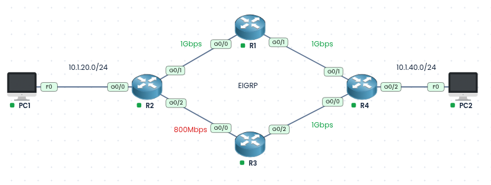
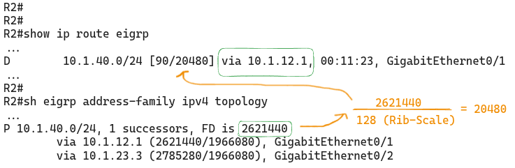
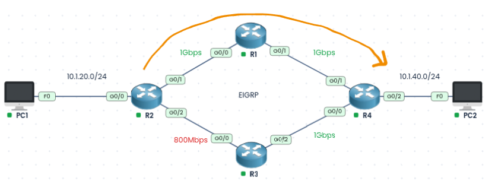
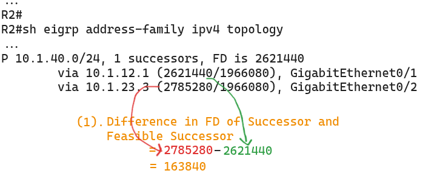
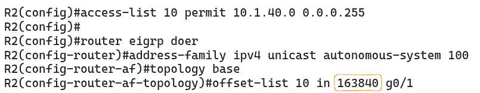
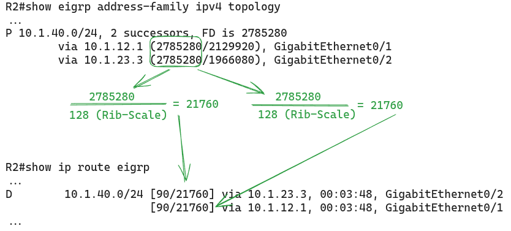
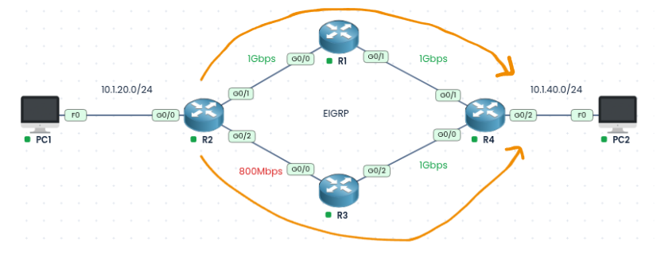

### Labs built using:
* [PingMyNetwork Sandbox](https://pingmynetwork.com/)
---
# EIGRP Equal-Cost MultiPath using Offset-List

### 1). Topology Overview
- R1, R2, R3, and R4 all run EIGRP (named mode), and every interface is advertised in EIGRP AS 100.
- PC1 (10.1.20.0/24) sits behind R2, and PC2 (10.1.40.0/24) sits behind R4.
- R2 has two paths to reach 10.1.40.0/24:
    - **Path 1:** R2 > R1 > R4, with 1 Gbps on every link.
    - **Path 2:** R2 > R3 > R4, where the R2-R3 link is only 800 Mbps.
- EIGRP metric depends on the lowest bandwidth and the total delay along the path. Path 2 has a slower link, so it gets a higher metric.
- By default, R2 installs only the best path (via R1) in the routing table. The R3 path sits idle as a feasible successor, even though it has plenty of capacity.
- **Goal:** Use an `offset-list` on R2 to raise the metric of the path via R1 until it equals the path via R3, so traffic to 10.1.40.0/24 is shared **equally** across both (ECMP).
### 2). Analyzing on R2
* R2 installs the successor route for 10.1.40.0/24 in the routing table. Since EIGRP named mode is used, the successor’s FD is divided by the RIB-scale (default 128) and the result is installed as the route metric.
* 
* Current Traffic flow
* 
### 3). Configuration and Results
* **Find the FD difference** between the successor and the feasible successor in `show eigrp address-family ipv4 topology`:
* 
* **Create an ACL** matching the prefix 10.1.40.0/24, then apply an offset-list that adds 163840 to the metric of that prefix when it is received on R2’s Gi0/1 (the interface toward R1):
* 
* This makes the FD of the successor and the feasible successor the same (**2785280**), so both are installed in the routing table, achieving ECMP.
* 
* Resulted Traffic Flow:
* 