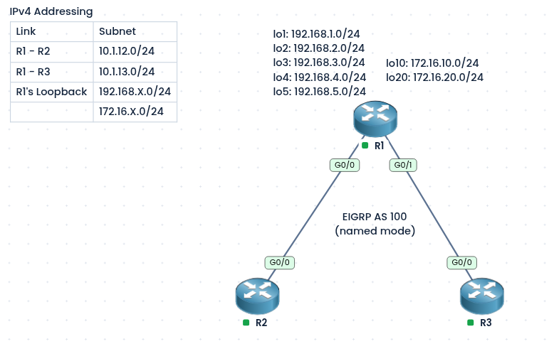
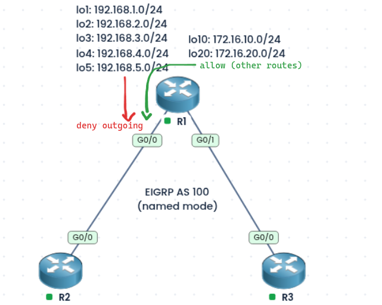
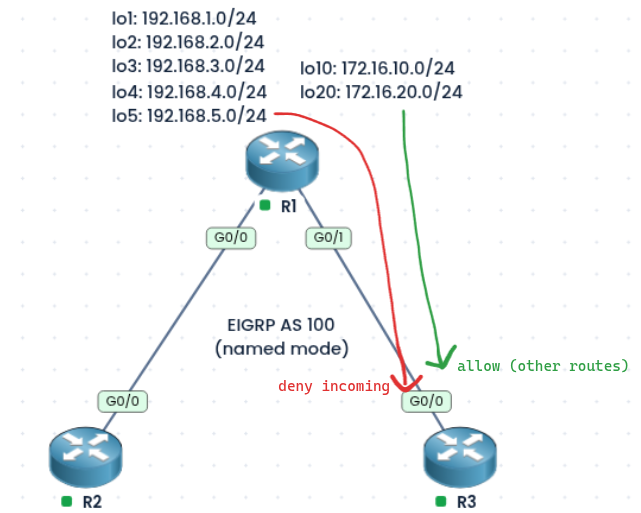
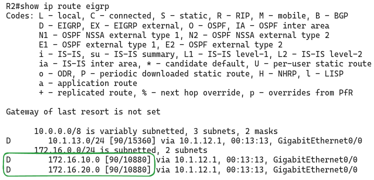
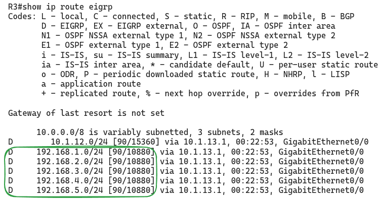

### Labs built using
- [PingMyNetwork Sandbox](https://pingmynetwork.com/profile/doer)
---
## EIGRP Route Filtering in Named Mode

#### 1). Topology Overview
- R1, R2, and R3 run EIGRP named mode (AS 100).
- R1 has seven loopbacks: `Lo1` to `Lo5` (`192.168.1.0/24` to `192.168.5.0/24`) and `Lo10` and `Lo20` (`172.16.10.0/24` and `172.16.20.0/24`). All are advertised in EIGRP.
- R1 connects to R2 (`10.1.12.0/24`) and to R3 (`10.1.13.0/24`).
- **Goal 1 (outbound filter on R1):**
	- R2 must **not receive** the `192.168.x.0/24` prefixes, but it should still receive the `172.16.x.0/24` prefixes. So we filter on R1 in the **outbound** direction toward R2, using a prefix list and a distribute list.
- **Goal 2 (inbound filter on R3):**
	- In this scenario we have **no access to R1**
		- R3 must **not receive** the `172.16.x.0/24` prefixes. So we cannot filter outbound there. Instead, we filter **inbound** on R3, using an access list, a route-map, and a distribute list.
---
#### 2). Theory
- A **distribute-list** filters the routes EIGRP **sends** (`out`) or **receives** (`in`) on an interface.
- It can use an ACL, a prefix list, or a route-map to decide which prefixes to permit or deny.
- **Outbound** filtering stops the neighbor from learning the route at all. **Inbound** filtering only stops the local router from installing and passing on the route, but the neighbor still sends it.
- In named mode, the distribute-list is configured under `topology base`.
---
#### 3). Base Configuration
- R1:
```
router eigrp doer
 address-family ipv4 unicast autonomous-system 100
  eigrp router-id 1.1.1.1
  network 10.1.12.1 0.0.0.0
  network 10.1.13.1 0.0.0.0
  network 192.168.0.0 0.0.255.255
  network 172.16.10.1 0.0.0.0
  network 172.16.20.1 0.0.0.0
```
- R2:
```
router eigrp doer
 address-family ipv4 unicast autonomous-system 100
  eigrp router-id 2.2.2.2
  network 10.1.12.2 0.0.0.0
```
- R3:
```
router eigrp doer
 address-family ipv4 unicast autonomous-system 100
  eigrp router-id 3.3.3.3
  network 10.1.13.3 0.0.0.0
```
---
#### 4). Goal 1: Outbound Filter on R1 (Prefix List)

- The prefix list denies the `192.168.x.0/24` prefixes and permits everything else, and it is applied **outbound** on R1’s `Gi0/0` (toward R2).
- `192.168.0.0/21 ge 24 le 24` matches only `/24` prefixes inside `192.168.0.0/21`, which covers `192.168.0.0` to `192.168.7.0`, so `Lo1` to `Lo5` are matched.
- R1:
```
ip prefix-list 192s seq 5 deny 192.168.0.0/21 ge 24 le 24
ip prefix-list 192s seq 10 permit 0.0.0.0/0 le 32

router eigrp doer
 address-family ipv4 unicast autonomous-system 100
  topology base
   distribute-list prefix 192s out G0/0
  exit-af-topology
```
- NOTE:
    - A prefix list ends with an implicit deny, so `permit 0.0.0.0/0 le 32` is needed to allow all other routes (the `172.16.x.0/24` loopbacks and the links).
    - R3 is not affected, because the filter is applied only toward R2.
---
#### 5). Goal 2: Inbound Filter on R3 (ACL and Route-Map)

- Since we cannot change R1, the filter is applied on R3 for routes **received** from R1.
- An ACL matches the `172.16.10.0/24` and `172.16.20.0/24` prefixes, and a route-map **denies** them and **permits** everything else. The route-map is applied **inbound** on R3’s `Gi0/0`.
- R3:
```
ip access-list standard 172s
 permit 172.16.10.0 0.0.0.255
 permit 172.16.20.0 0.0.0.255

route-map RM-172s deny 10
 match ip address 172s
route-map RM-172s permit 20

router eigrp doer
 address-family ipv4 unicast autonomous-system 100
  topology base
   distribute-list route-map RM-172s in G0/0
  exit-af-topology
```
- NOTE:
    - The route-map first **denies** the 172s prefixes (sequence 10), then **permits** everything else (sequence 20). Without `permit 20`, the implicit deny would block all routes.
    - R3 still receives the `192.168.x.0/24` prefixes, because only the 172s are denied.
---
#### 6). Verification
- On R2, `show ip route eigrp` should show the `172.16.10.0/24` and `172.16.20.0/24` routes, and **no** `192.168.x.0/24` routes.
- 
- On R3, `show ip route eigrp` should show the `192.168.x.0/24` routes, and **no** `172.16.x.0/24` routes.
- 