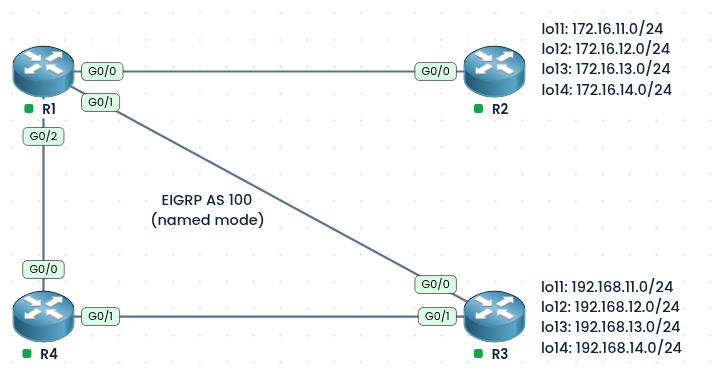
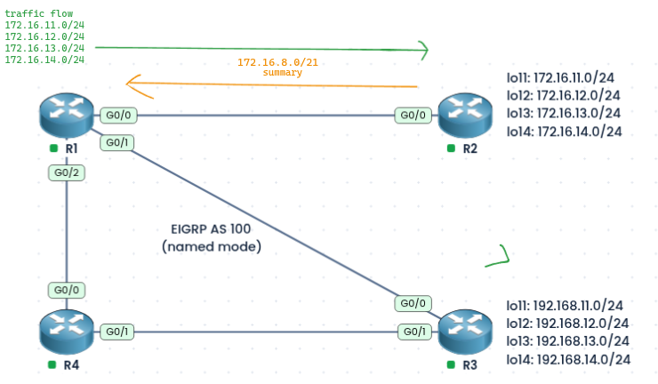
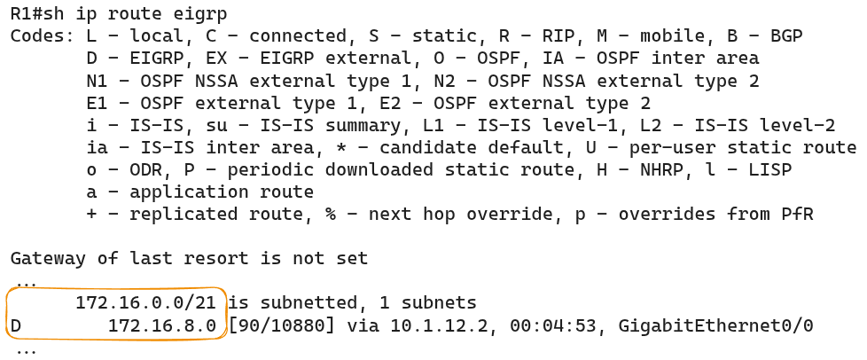
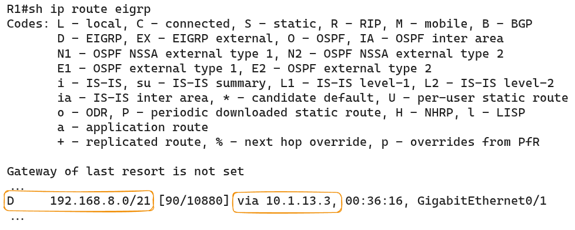
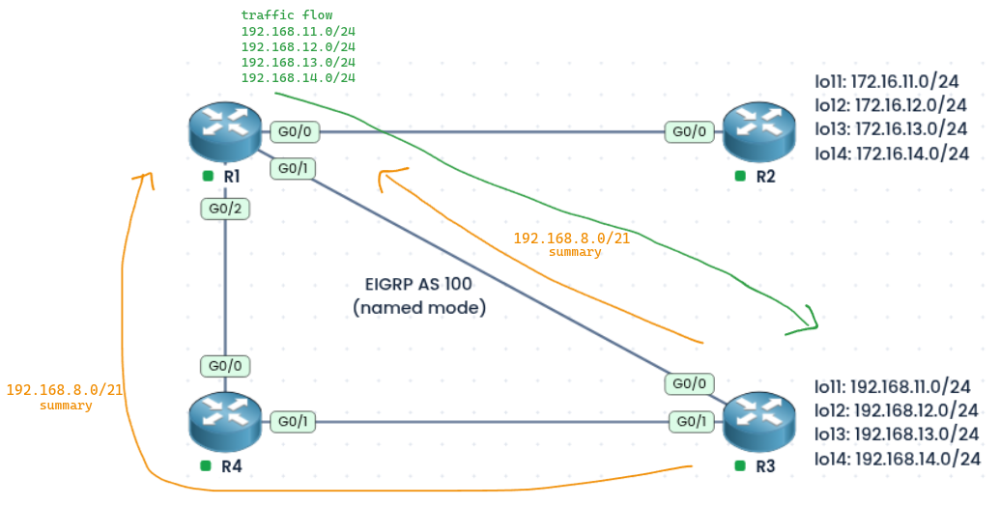
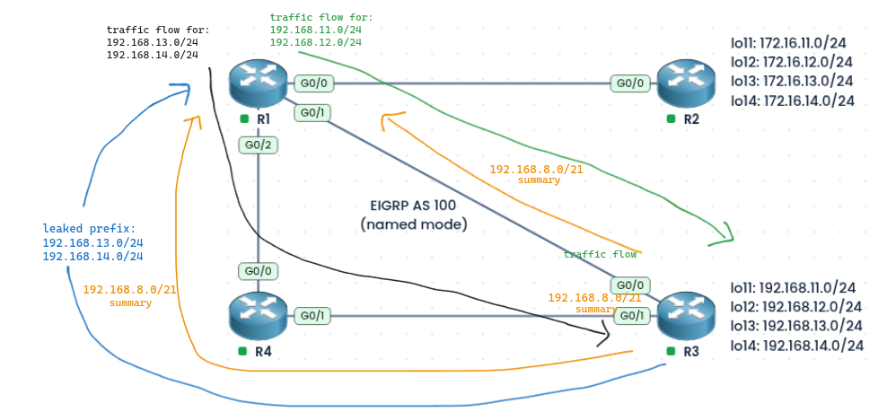
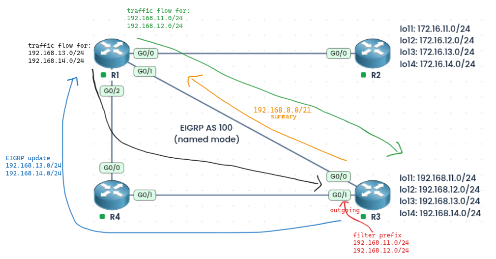
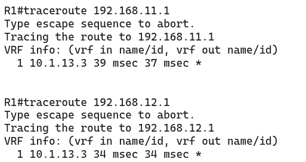
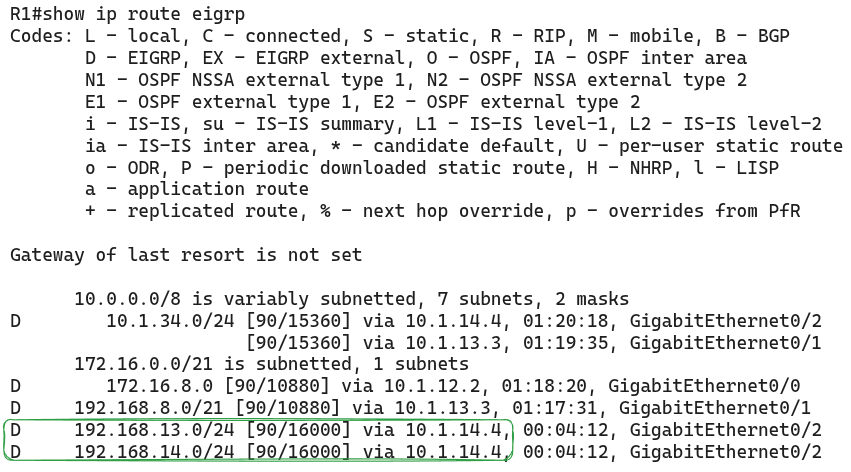
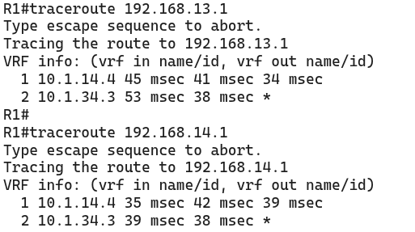

#### Labs built using:
- [PingMyNetwork Sandbox](https://pingmynetwork.com/profile/doer)
---
## EIGRP Summarization in Named-Mode

#### 1). Topology Overview
- R1, R2, R3, and R4 all run EIGRP named mode (AS 100).
- R2 has four loopbacks (`172.16.11.0/24` to `172.16.14.0/24`), and R3 has four loopbacks (`192.168.11.0/24` to `192.168.14.0/24`).
- R2 summarizes its loopbacks into `172.16.8.0/21` toward R1.
- R3 summarizes its loopbacks into `192.168.8.0/21` toward both R1 and R4.
- **Goal:**
	- R1 should still use R3 for `192.168.11.0/24` and `192.168.12.0/24`, but use R4 for `192.168.13.0/24` and `192.168.14.0/24`.
---
#### 2). Finding the Summary Address
- Write the third octet of each network in binary and find the bits they share:

|Network|Third octet (binary)|
|---|---|
|192.168.11.0|000010**11**|
|192.168.12.0|000011**00**|
|192.168.13.0|000011**01**|
|192.168.14.0|000011**10**|

- The first 5 bits (`00001`) are the same in all four, so the summary is `192.168.00001000.0` = **`192.168.8.0/21`** (16 + 5 = 21 bits, mask `255.255.248.0`).
- Similarly for R2's it's = `172.16.8.0/21`
---
#### 3). Base Configuration (EIGRP and Summarization)
- Every router advertises its links with `network` statements. R2 and R3 summarize their loopbacks on the interface facing R1.
- R1:
```
router eigrp doer
 address-family ipv4 unicast autonomous-system 100
  eigrp router-id 1.1.1.1
  network 10.1.12.1 0.0.0.0
  network 10.1.13.1 0.0.0.0
  network 10.1.14.1 0.0.0.0
```
- R2:
```
router eigrp doer
 address-family ipv4 unicast autonomous-system 100
  eigrp router-id 2.2.2.2
  network 10.1.12.2 0.0.0.0
  network 172.16.11.1 0.0.0.0
  network 172.16.12.1 0.0.0.0
  network 172.16.13.1 0.0.0.0
  network 172.16.14.1 0.0.0.0
  af-interface GigabitEthernet0/0
   summary-address 172.16.8.0 255.255.248.0
```
* R3:
```
router eigrp doer
 address-family ipv4 unicast autonomous-system 100
  eigrp router-id 3.3.3.3
  network 10.1.13.3 0.0.0.0
  network 10.1.34.3 0.0.0.0
  network 192.168.11.1 0.0.0.0
  network 192.168.12.1 0.0.0.0
  network 192.168.13.1 0.0.0.0
  network 192.168.14.1 0.0.0.0
  af-interface G0/0
   summary-address 192.168.8.0 255.255.248.0
   exit-af-interface
  af-interface G0/1
   summary-address 192.168.8.0 255.255.248.0
```
- R4:
```
router eigrp doer
 address-family ipv4 unicast autonomous-system 100
  eigrp router-id 4.4.4.4
  network 10.1.14.4 0.0.0.0
  network 10.1.34.4 0.0.0.0
```
---
#### 4). Analyzing
- R2’s summary on R1
	- 
	- 
- R3’s summary on R1
	- R1 receives the `192.168.8.0/21` summary of R3’s loopbacks both directly from R3 (`10.1.13.3`, Gi0/1) and via R4. R1 chooses the path via R3 because it has the lowest feasible distance, and the path via R4 is longer.
	- 
	- 
---
#### 5). Option 1: Leak-Map on R3

- A **leak-map** lets R3 send the summary **and** the specific routes matched by the map. Here, R3 leaks `192.168.13.0/24` and `192.168.14.0/24` to R4.
- R4 then passes the two specifics to R1. R1 uses the longest match, so traffic for lo13 and lo14 goes via R4, and lo11 and lo12 still follow the summary via R3.
- R3:
```
ip access-list standard lo13-n-14-prefix
 permit 192.168.13.0 0.0.0.255
 permit 192.168.14.0 0.0.0.255

route-map LEAK-Lo13-14 permit 10
 match ip address lo13-n-14-prefix

router eigrp doer
 address-family ipv4 unicast autonomous-system 100
  af-interface G0/0
   summary-address 192.168.8.0 255.255.248.0
   exit-af-interface
  af-interface G0/1
   summary-address 192.168.8.0 255.255.248.0 leak-map LEAK-Lo13-14
```
- NOTE:
	- `leak-map` does not work on the PingMyNetwork sandbox router. Use another platform such as vIOS or Cisco IOS XE. If you are on the sandbox, use Option 2.
---
#### 6). Option 2: Route Filter on R3 (Alternative)

- Instead of a leak-map, R3 does not summarize toward R4. It sends R4 the specific routes, and a route-map filters the outgoing updates on Gi0/1 so that `192.168.11.0/24` and `192.168.12.0/24` are **blocked**, and everything else (including lo13 and lo14) is allowed.
- R4 learns only lo13 and lo14 from R3 and passes them to R1. R1 prefers them (longest match), so traffic for lo13 and lo14 goes via R4, while lo11 and lo12 still follow the summary via R3.
- Make sure to remove the summary address in `G0/0` Interface in Section 3
- R3:
```
ip access-list standard lo11-n-12-prefix
 permit 192.168.11.0 0.0.0.255
 permit 192.168.12.0 0.0.0.255

route-map rf-lo11-12 deny 10
 match ip address lo11-n-12-prefix
route-map rf-lo11-12 permit 20

router eigrp doer
 address-family ipv4 unicast autonomous-system 100
  af-interface G0/0
   no summary-address 192.168.8.0 255.255.248.0
   exit-af-interface
  af-interface G0/0
   summary-address 192.168.8.0 255.255.248.0
   exit-af-interface
  topology base
   distribute-list route-map rf-lo11-12 out G0/1
```
- NOTE:
	* The route-map first **denies** lo11 and lo12 (sequence 10), then **permits** everything else (sequence 20), so lo13, lo14, and the other routes are still sent to R4. Without the `permit 20` line, the implicit deny would block all routes.
---
#### 7). Verification
- On R1, `192.168.11.0/24` and `192.168.12.0/24` should be reached through the `192.168.8.0/21` summary via R3 (`10.1.13.3`).
- 
- On R1, `192.168.13.0/24` and `192.168.14.0/24` should be reached via R4 (`10.1.14.4`).
- 
-  
---
#### NOTE
- On R3 (and R2), the summary route creates an automatic `Null0` route with AD `5`, which drops traffic for addresses inside the summary that have no specific route and so prevents loops.
- Set `summary-metric <summary-addr/prefix> distance 255` (inside `topology base`) only if you want to remove it, for example when a less specific route (like a default) should handle that traffic instead of being blackholed.