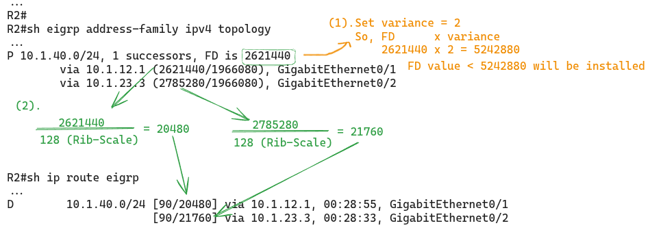
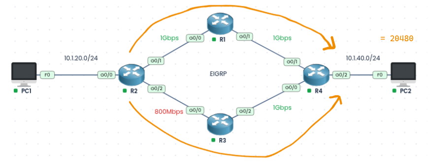

### Labs built using:
* [PingMyNetwork Sandbox](https://pingmynetwork.com/)
---
# Unequal Cost Load Balancing in EIGRP using Variance

### 1). Topology Overview
- R1, R2, R3, and R4 all run EIGRP (named mode), and every interface is advertised in EIGRP AS 100.
- PC1 (10.1.20.0/24) sits behind R2, and PC2 (10.1.40.0/24) sits behind R4.
- R2 has two paths to reach 10.1.40.0/24:
    - **Path 1:** R2 > R1 > R4, with 1 Gbps on every link.
    - **Path 2:** R2 > R3 > R4, where the R2-R3 link is only 800 Mbps.
- EIGRP metric depends on the lowest bandwidth and the total delay along the path. Path 2 has a slower link, so it gets a higher metric.
- By default, R2 installs only the best path (via R1) in the routing table. The R3 path sits idle as a backup, even though it has plenty of capacity.
- **Goal:** Use `variance` on R2 so that traffic to 10.1.40.0/24 is shared across both R1 and R3, with more traffic sent over the better path.
### 2). Analyzing on R2
* R2 installs the successor route for 10.1.40.0/24 in the routing table, and since EIGRP named mode is used, the successor’s FD is divided by the RIB-scale (default 128) and the result is installed as the route metric.
* 
* Current Traffic flow
* 
### 3). Configuration and Results
* In R2 change the Variance value to 2
```
router eigrp doer
 address-family ipv4 unicast autonomous-system 100
  topology base
   variance 2
```
* **Result:** After setting variance = 2 on R2, the Feasible Successor via R3 (FD 2785280) falls within the limit of 5242880 (2621440 × 2), so both paths are installed in the routing table with metrics 20480 and 21760, and R2 load-balances traffic to 10.1.40.0/24 across R1 and R3.
* 
* Resulted Traffic Flow:
* 