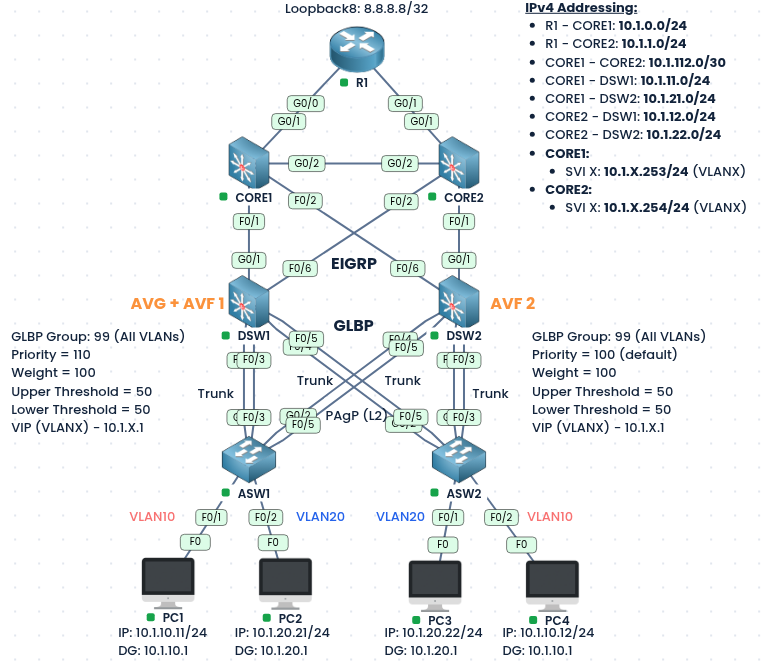
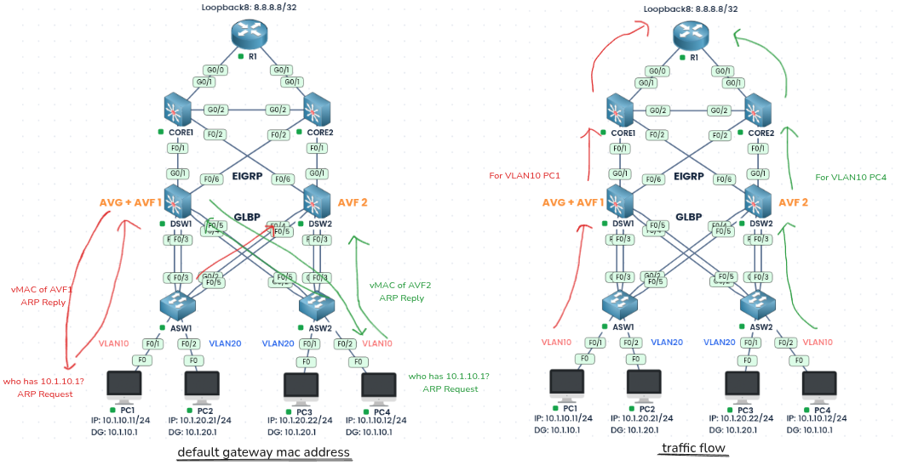
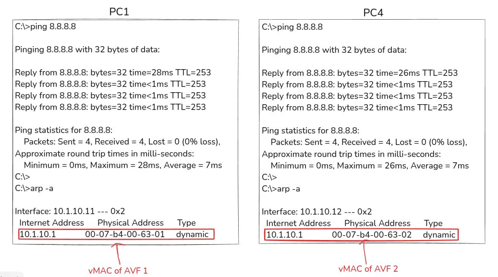
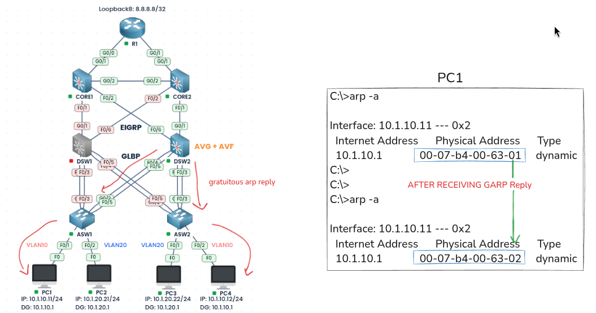
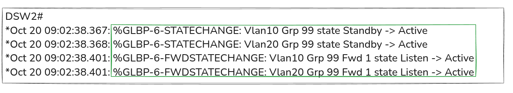
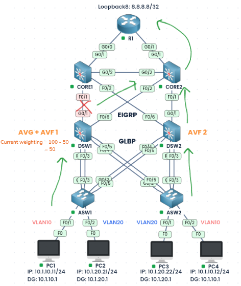
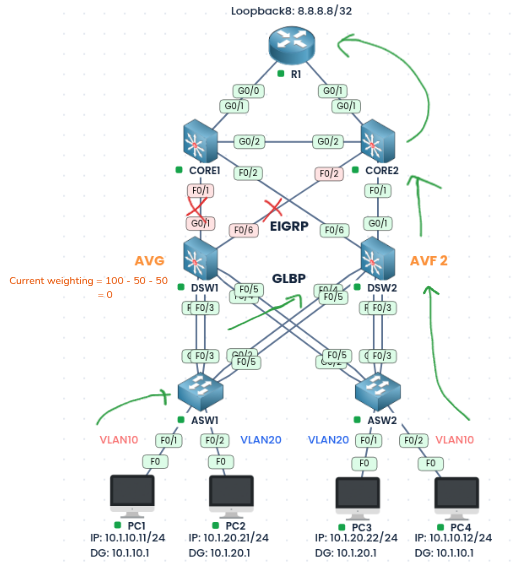
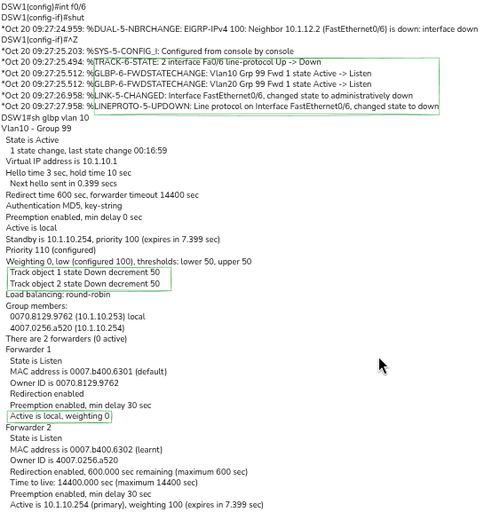

### Labs built using:
* [PingMyNetwork Sandbox](https://pingmynetwork.com/profile/doer)
---
# GLBP Weighting with Tracking

#### 1). Topology Overview
- R1, CORE1, and CORE2 run EIGRP, and DSW1 and DSW2 also run EIGRP toward the cores. Each DSW connects to both CORE1 and CORE2 over routed links (see the IPv4 Addressing label), and the DSW SVIs are advertised into EIGRP with `passive-interface` configured on the SVIs
- DSW1 and DSW2 are connected to ASW1 and ASW2 using PAgP Layer 2 trunk port-channels.
- Each ASW has hosts in both VLANs
- DSW1 and DSW2 hold the SVIs shown in the IPv4 Addressing label.
---
#### 2). Configuration of GLBP
- Run GLBP group `99` for all VLANs on DSW1 and DSW2, with the virtual IP `10.1.X.1`, which is the default gateway of each PC. (Where `X` is the VLAN Number)
- DSW1 will be configured with priority `110`, so it becomes the **AVG** and also an AVF (AVF1). DSW2 keeps the default priority `100`, so it is the standby AVG and AVF2.
- NOTE:
    - In GLBP, preemption of the AVG role is disabled by default and must be enabled with `glbp <group> preempt`.
    - AVF (forwarder) preempt is separate and on by default

| GLBP Group | VLANs  | DSW1                      | DSW2                              |
| ---------- | ------ | ------------------------- | --------------------------------- |
| 99         | 10, 20 | Priority 110 (AVG + AVF1) | Priority 100 (Standby AVG + AVF2) |

* DSW1:
```
spanning-tree vlan 10 priority 0

interface Vlan10
 glbp 99 ip 10.1.10.1
interface Vlan20
 glbp 99 ip 10.1.20.1

interface range vlan10,vlan20
 glbp 99 priority 110
 glbp 99 preempt
 glbp 99 authentication md5 key-string glbp007
```
* DSW2:
```
spanning-tree vlan 20 priority 0

interface Vlan10
 glbp 99 ip 10.1.10.1
interface Vlan20
 glbp 99 ip 10.1.20.1

interface range vlan10,vlan20
 glbp 99 preempt
 glbp 99 authentication md5 key-string glbp007
```
---
#### 3). Configuring Weighting and Tracking
- Both switches use a weight of `100` with the lower and upper thresholds at `50`, so a switch stops forwarding when its weight falls below `50`.
- Each DSW tracks the line-protocol state of its two uplinks (to CORE1 and CORE2), and each track lowers the weight by `50` when it goes Down.
- DSW1:
```
track 1 interface g0/1 line-protocol
track 2 interface f0/6 line-protocol
interface range vlan10,vlan20
 glbp 99 weighting 100 lower 50 upper 50
 glbp 99 weighting track 1 decrement 50
 glbp 99 weighting track 2 decrement 50
```
- DSW2:
```
track 1 interface g0/1 line-protocol
track 2 interface f0/6 line-protocol
interface range vlan10,vlan20
 glbp 99 weighting 100 lower 50 upper 50
 glbp 99 weighting track 1 decrement 50
 glbp 99 weighting track 2 decrement 50
```

- When one Uplink goes down, the weight drops by `50` (100 to 50), and the DSW keeps forwarding because 50 is not below the lower threshold. When both uplinks go down, the weight drops to `0`, which is below `50`, so the DSW stops forwarding and the other DSW handles all the traffic.
---
#### 4). Resultant Traffic Flow
* The AVG answers ARP requests for the virtual IP in round-robin, handing out the virtual MAC of DSW1 to some hosts and of DSW2 to others, so traffic from each VLAN is shared across both DSWs.
* 
* 
---
#### 5). Analyzing Failures
* NOTE: VLAN10 is used as an example here
* 1). When DSW1 goes down:
	* When DSW1 fails, DSW2 becomes the AVG and sends a gratuitous ARP reply to the hosts in VLAN 10. PC1’s ARP entry for 10.1.10.1 changes from `00-07-b4-00-63-01` (DSW1’s AVF1) to `00-07-b4-00-63-02` (DSW2’s AVF2), so its traffic now goes through DSW2.
	* 
	* 
* 2). When one tracked uplink of DSW1 goes down
	* When the uplink DSW1 Gi0/1 to CORE1 goes down, its track object fails and the weight drops by `50`. Since `50` is not below the lower threshold of `50`, DSW1 stays an AVF and keeps forwarding, sending its traffic through the remaining uplink (Fa0/6 to CORE2)
	* 
* 3). When both tracked uplink of DSW1 go down
	* When both tracked uplinks of DSW1 (to CORE1 and CORE2) go down, the weight drops by `50` for each track (100 - 50 - 50 = 0). Since 0 is below the lower threshold of `50`, DSW1 stops being an AVF and no longer forwards traffic. DSW2 (AVF2) takes over all the forwarding, and DSW1 remains the AVG because weighting does not affect the AVG role.
	* 
	* 