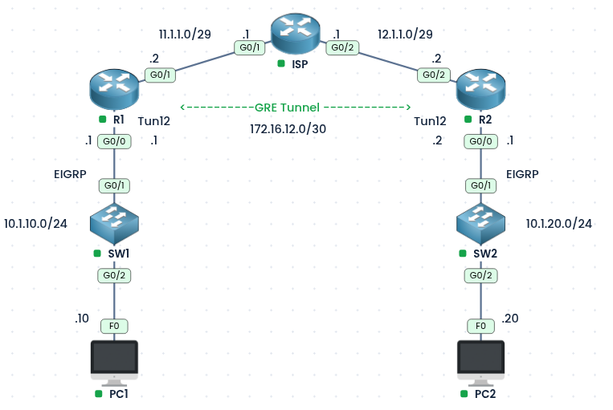
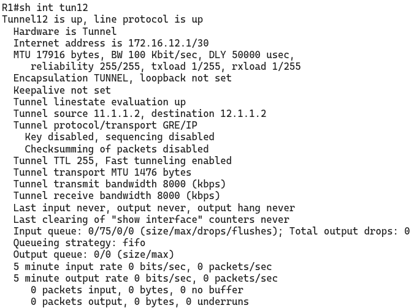
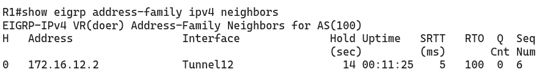
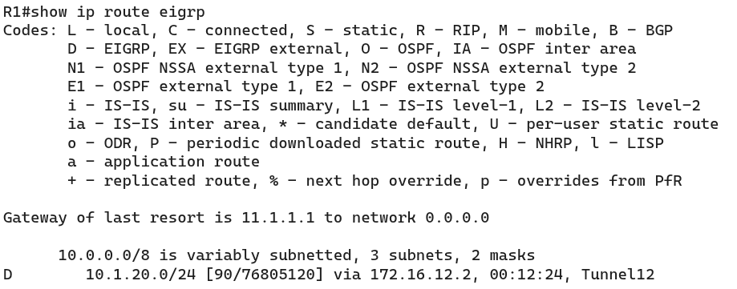
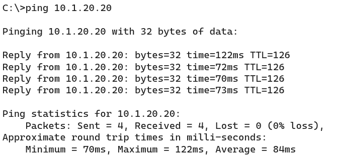

#### Labs built using:

- [PingMyNetwork Sandbox](https://pingmynetwork.com/profile/doer)
---
## GRE Tunnel with EIGRP

#### 1). Topology Overview
- R1 and R2 connect to the ISP router, which only knows the public networks (`11.1.1.0/29` and `12.1.1.0/29`). It has no routes to the private LANs.
- A **GRE tunnel** (`Tunnel12`, `172.16.12.0/30`) is built between R1 (`11.1.1.2`) and R2 (`12.1.1.2`), so the two LANs can talk through the ISP.
- R1’s LAN is `10.1.10.0/24` (PC1) and R2’s LAN is `10.1.20.0/24` (PC2).
- R1 and R2 run **EIGRP** over the tunnel to share their LANs, so no static routes are needed for the LANs.
- **Goal:** PC1 and PC2 can reach each other through the GRE tunnel.
---
#### 2). Configuration
##### Step 1: Default route to the ISP
- The tunnel endpoints (`11.1.1.2` and `12.1.1.2`) must reach each other, so each router needs a default route toward the ISP.
```
! R1
ip route 0.0.0.0 0.0.0.0 G0/1 11.1.1.1

! R2
ip route 0.0.0.0 0.0.0.0 G0/2 12.1.1.1
```
##### Step 2: GRE tunnel
```
! R1
interface tunnel12
 ip address 172.16.12.1 255.255.255.252
 tunnel source 11.1.1.2
 tunnel destination 12.1.1.2

! R2
interface tunnel12
 ip address 172.16.12.2 255.255.255.252
 tunnel source 12.1.1.2
 tunnel destination 11.1.1.2
```
##### Step 3: EIGRP over the tunnel
- Only the LAN-facing interface and the tunnel are advertised in EIGRP. The ISP-facing interfaces are not, so the public networks never enter the tunnel.
- The LAN interface (`Gi0/0`) is made **passive**. Its network is still advertised, but no EIGRP Hellos are sent toward the LAN, where there are no EIGRP neighbors.
```
! R1
router eigrp doer
 address-family ipv4 unicast autonomous-system 100
  af-interface G0/0
   passive-interface
  exit-af-interface
  topology base
  exit-af-topology
  network 10.1.10.1 0.0.0.0
  network 172.16.12.1 0.0.0.0
 exit-address-family

! R2
router eigrp doer
 address-family ipv4 unicast autonomous-system 100
  af-interface G0/0
   passive-interface
  exit-af-interface
  topology base
  exit-af-topology
  network 10.1.20.1 0.0.0.0
  network 172.16.12.2 0.0.0.0
 exit-address-family
```
- NOTE:
    - In EIGRP named mode, passive interface is set under `af-interface <interface>` with `passive-interface`, not with the classic `passive-interface` command under the router.
    - Do **not** make `Tunnel12` passive, or the EIGRP neighbor will not form.
---
#### 3). Verification
* Tunnel Interface in R1
* 
- `show eigrp address-family ipv4 neighbors` on R1 should list `172.16.12.2` (and the reverse on R2).
- 
- `show ip route eigrp` on R1 should show `10.1.20.0/24` learned via `Tunnel12`.
- 
- Ping from PC1 to PC2 (`10.1.20.20`) to confirm.
- 
---
#### 4). Advantages and Disadvantages of GRE
* Advantages
	- Simple to configure
	- Supports multicast, so routing protocols like EIGRP and OSPF work over it
	- Carries many protocols (IPv4, IPv6, and others)
	- Lets private networks cross a network that has no route to them
* Disadvantages
	- No encryption (usually paired with IPsec)
	- Adds a 24-byte header, which can cause MTU and fragmentation issues
	- Point-to-point only, so many sites need many tunnels (DMVPN solves this)