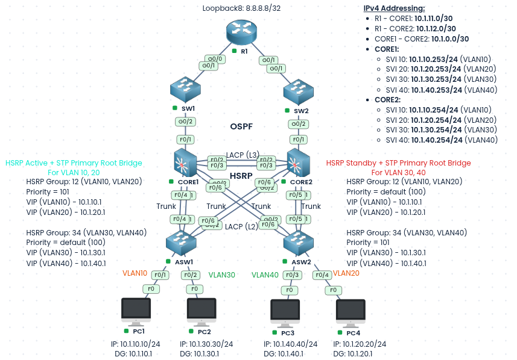
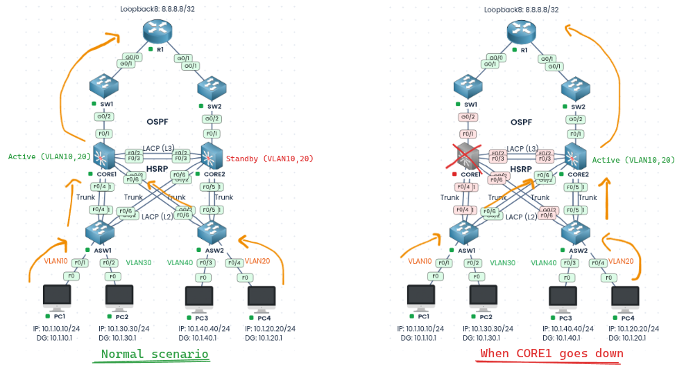
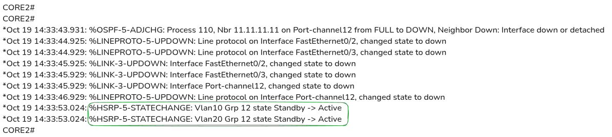
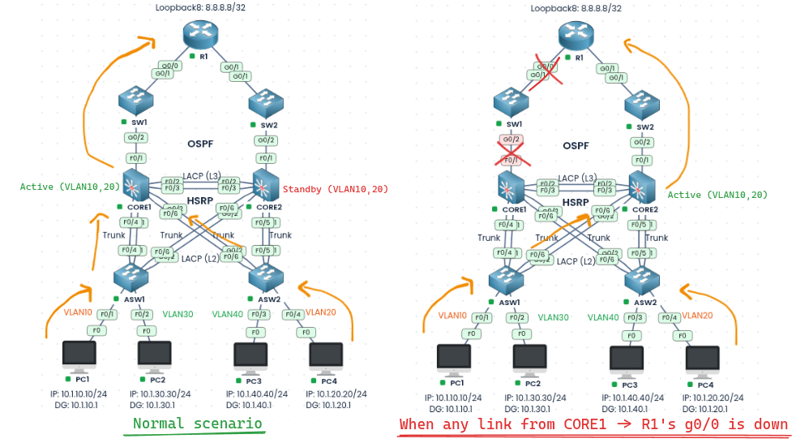
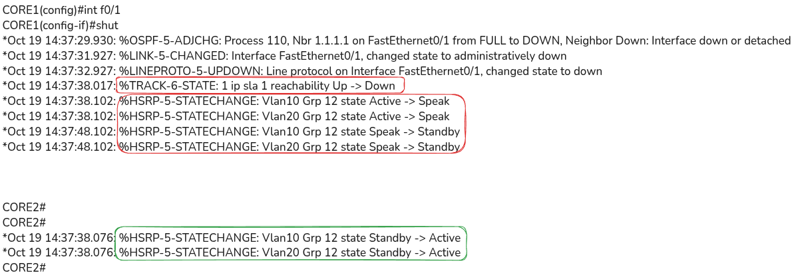

### Labs built using:
* [PingMyNetwork Sandbox](https://pingmynetwork.com/profile/doer)
---
# HSRPv2 Multi-Group Load Balancing with Tracking

#### 1). Topology Overview
- R1, CORE1, and CORE2 run OSPF, CORE1 and CORE2 SVIs are advertised into OSPF
- CORE1 and CORE2 are connected to each other by an LACP port-channel (F0/2 and F0/3) running as a Layer 3 link on `10.1.0.0/30`
- ASW1 and ASW2 are access switches, and each is connected to both CORE1 and CORE2 using `Trunk` links.
- Hosts are placed in four VLANs shown above
- The default gateway of each PC is the HSRP virtual IP of its VLAN (for example `10.1.10.1` for VLAN 10).
- CORE1 and CORE2 hold the SVIs shown in IPv4 Addressing Label
---
#### 2). Configuration of HSRP and STP
- Make the HSRP Active and the STP root bridge the same switch for each VLAN, so Layer 2 traffic and Layer 3 traffic follow the same path and no traffic has to cross the inter-core link to reach its gateway. Both cores are also actively used, so one is not sitting idle as a standby.
- NOTE:
	- In HSRP, preemption is disabled by default and must be enabled with `standby <group> preempt`.

| HSRP Group | VLANs  | CORE1                  | CORE2                  |
| ---------- | ------ | ---------------------- | ---------------------- |
| 12         | 10, 20 | Priority 101 (Active)  | Priority 100 (Standby) |
| 34         | 30, 40 | Priority 100 (Standby) | Priority 101 (Active)  |
* CORE1:
```
spanning-tree vlan 10,20 priority 0
interface Vlan10
 standby version 2
 standby 12 ip 10.1.10.1
 standby 12 priority 101
 standby 12 preempt
 standby 12 authentication md5 key-string hsrp007
interface Vlan20
 standby version 2
 standby 12 ip 10.1.20.1
 standby 12 priority 101
 standby 12 preempt
 standby 12 authentication md5 key-string hsrp007
interface Vlan30
 standby version 2
 standby 34 ip 10.1.30.1
 standby 34 preempt
 standby 34 authentication md5 key-string hsrp007
interface Vlan40
 standby version 2
 standby 34 ip 10.1.40.1
 standby 34 preempt
 standby 34 authentication md5 key-string hsrp007
```
* CORE2:
```
spanning-tree vlan 30,40 priority 0
interface Vlan10
 standby version 2
 standby 12 ip 10.1.10.1
 standby 12 preempt
 standby 12 authentication md5 key-string hsrp007
interface Vlan20
 standby version 2
 standby 12 ip 10.1.20.1
 standby 12 preempt
 standby 12 authentication md5 key-string hsrp007
interface Vlan30
 standby version 2
 standby 34 ip 10.1.30.1
 standby 34 priority 101
 standby 34 preempt
 standby 34 authentication md5 key-string hsrp007
interface Vlan40
 standby version 2
 standby 34 ip 10.1.40.1
 standby 34 priority 101
 standby 34 preempt
 standby 34 authentication md5 key-string hsrp007
```
---
#### 3). Configuring Tracking
* CORE1:
```
ip sla 1
 icmp-echo 10.1.11.1 source-interface FastEthernet0/1
  frequency 5
ip sla schedule 1 life forever start-time now
track 1 ip sla 1 reachability
interface range vlan10,vlan20
 standby 12 track 1 decrement 2
```
* CORE2:
```
ip sla 1
 icmp-echo 10.1.12.1 source-interface FastEthernet0/1
  frequency 5
ip sla schedule 1 life forever start-time now
track 1 ip sla 1 reachability
interface range vlan30,vlan40
 standby 34 track 1 decrement 2
```
* An IP SLA ICMP probe from each CORE switch to R1 is tracked, and when the link to R1 fails, the HSRP priority of the Active CORE drops by `2`, which makes it `99` (less than the default of `100` on the peer), so the other CORE takes over as the gateway.
---
#### 4). Analyzing Failures
* NOTE: VLAN10, VLAN20 is used as an example here
* 1). When CORE1 goes down
* 
* 
* 2). When any link from CORE1 -> R1's g0/0 is down
* 
* 