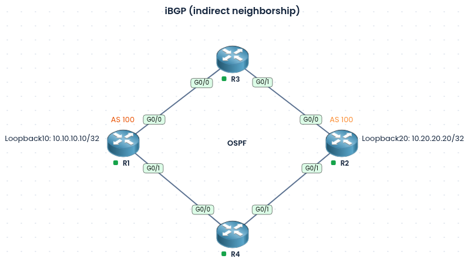

### Labs built using:
* [PingMyNetwork Sandbox](https://pingmynetwork.com/)
---
# iBGP Indirect Neighborship

### 1). Topology Overview
- R1 and R2 are both in AS 100 and are not directly connected. They reach each other through two redundant paths: R1 > R3 > R2 and R1 > R4 > R2.
- R3 and R4 are transit routers, and all four routers run OSPF.
- OSPF advertises the Loopback10 (10.10.10.10/32) on R1 and the Loopback20 (10.20.20.20/32) on R2, so each router can reach the other’s loopback.
- An iBGP neighborship is formed between R1 and R2 using the Loopback10 and Loopback20 addresses as the peering endpoints.
- NOTE:
	- By default iBGP packets use a TTL of 255, so loopback peering works without multihop
- Advantages of using indirect neighborship:
	- **1). Redundancy:** Two paths (via R3 and R4) mean one link or router failure doesn’t break the iBGP session.
	- **2). Load balancing:** OSPF can use both equal-cost paths to reach the peer loopback.
	- **3). Stable peering:** Loopbacks stay up as long as the router is up.
	- **4). Simple transit routers:** R3 and R4 only run OSPF, with no BGP needed.
	- **5). Easy to scale:** Adding links or routers doesn’t change the BGP peering.
### 2). Configuration
* R1 BGP configuration
```
router bgp 100
 no bgp default ipv4-unicast
 neighbor 10.20.20.20 remote-as 100
 neighbor 10.20.20.20 update-source loopback 10
 address-family ipv4
  neighbor 10.20.20.20 activate
```
* R2 BGP configuration
```
router bgp 100
 no bgp default ipv4-unicast
 neighbor 10.10.10.10 remote-as 100
 neighbor 10.10.10.10 update-source loopback 20
 address-family ipv4
  neighbor 10.10.10.10 activate
```
### 3). Verification
* R1
```
R1#show bgp ipv4 unicast summary
...
Neighbor      V  AS  MsgRcvd MsgSent TblVer InQ OutQ   Up/Down   State/PfxRcd
10.20.20.20   4 100       14      15      3   0    0   00:10:46        0
```
* R2
```
R2#show bgp ipv4 unicast summary
...
Neighbor      V  AS  MsgRcvd MsgSent TblVer InQ OutQ   Up/Down   State/PfxRcd
10.10.10.10   4 100       17      17      3   0    0   00:13:57         0
```