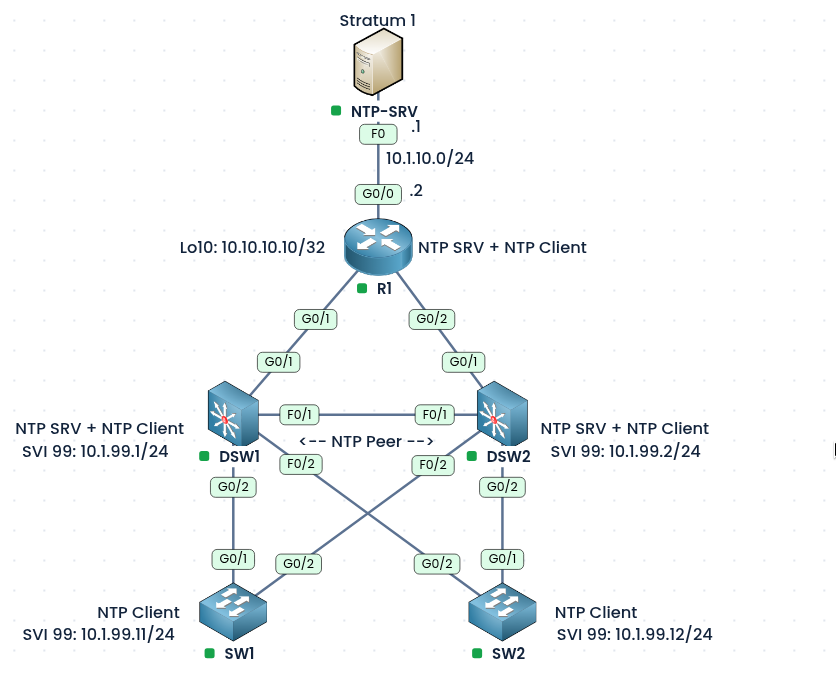
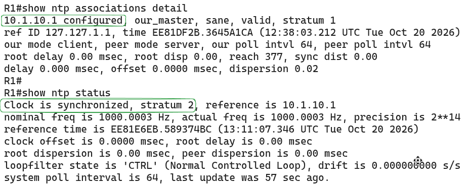
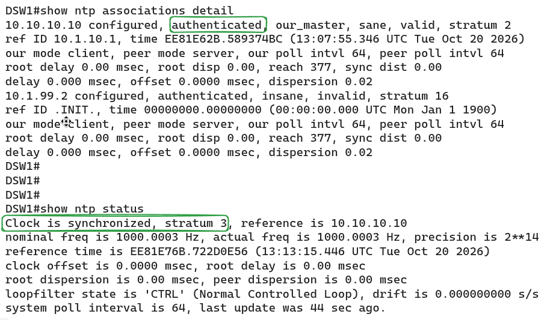
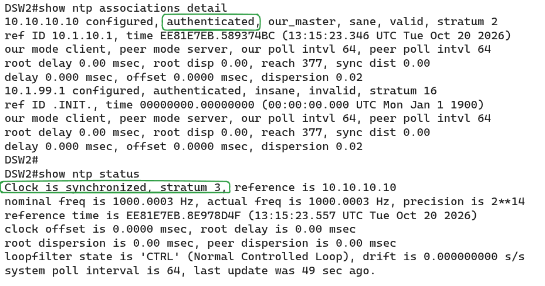
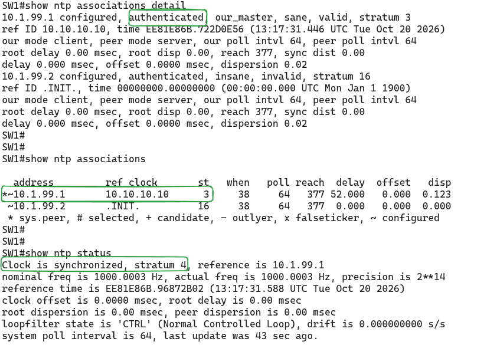
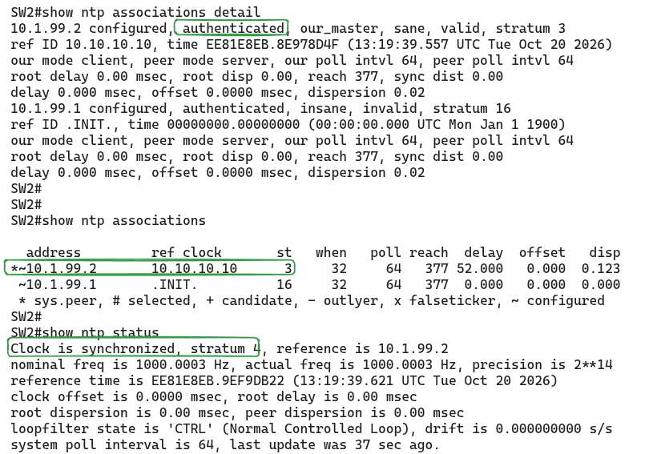

### Labs built using:
* [PingMyNetwork Sandbox](https://pingmynetwork.com/)
---
# NTP Authentication

#### 1). Topology Overview
- NTP-SRV is the main time source of the network (Stratum 1) and is connected directly to R1 (G0/0).
- R1 syncs its time from NTP-SRV and acts as an NTP server for DSW1 and DSW2. It uses Loopback10 (`10.10.10.10/32`) as its NTP source address. R1 is also configured as an NTP master (Stratum 5), so it can act as a backup time source if NTP-SRV becomes unreachable.
- DSW1 and DSW2 are NTP clients of R1 and NTP servers for the access switches. They are also NTP peers of each other, so they agree on one time even if R1 is lost.
- SW1 and SW2 are NTP clients only. Each one is connected to both DSW1 and DSW2, so each has two servers to sync from.
- This forms a tiered hierarchy, where each layer gets its time from the layer above it:
    - **NTP-SRV** > **R1** > **DSW1 <-> DSW2** > **SW1 / SW2**
---
##### 2). Configuration of NTP with Authentication
- Two authentication keys are used, one for each tier, so the access switches and the upper tiers do not share the same password:
    - `Key 1` (`ntp007`):
	    - between R1 and DSW1/DSW2
	    - between DSW1 and DSW2
    - `Key 100` (`ntpacc007`):
	    - between DSW1/DSW2 and SW1/SW2.
- DSW1 and DSW2 point to R1’s Loopback10 (`10.10.10.10`) instead of a link address, so the session survives if one of the two links to R1 fails.
- SW1 and SW2 use both DSWs as servers, with one preferred.
- R1 uses `ntp master 5` as a fallback. While NTP-SRV is reachable, R1 syncs to it and becomes Stratum 2, because the lower stratum always wins. If NTP-SRV goes down, R1 serves its own clock at Stratum 5, so the downstream devices stay synchronized with each other.
- DSW1 and DSW2 use `ntp peer` between each other, so if R1 is lost, they keep one common time instead of each serving its own clock.
- R1
```
ntp authentication-key 1 md5 ntp007
ntp trusted-key 1
ntp server 10.1.10.1
ntp source loopback 10
ntp master 5
```
* DSW1
```
ntp authentication-key 1 md5 ntp007
ntp authentication-key 100 md5 ntpacc007
ntp trusted-key 1
ntp trusted-key 100
ntp server 10.10.10.10 key 1
ntp peer 10.1.99.2 key 1
ntp authenticate
ntp source vlan 99
```
* DSW2
```
ntp authentication-key 1 md5 ntp007
ntp authentication-key 100 md5 ntpacc007
ntp trusted-key 1
ntp trusted-key 100
ntp server 10.10.10.10 key 1
ntp peer 10.1.99.1 key 1
ntp authenticate
ntp source vlan 99
```
* SW1
```
ntp authentication-key 100 md5 ntpacc007
ntp trusted-key 100
ntp server 10.1.99.1 key 100 prefer
ntp server 10.1.99.2 key 100
ntp authenticate
ntp source vlan 99
```
* SW2
```
ntp authentication-key 100 md5 ntpacc007
ntp trusted-key 100
ntp server 10.1.99.2 key 100 prefer
ntp server 10.1.99.1 key 100
ntp authenticate
ntp source vlan 99
```
---
#### 3). Verification
* NOTE:
	- R1 to NTP-SRV: NTP authentication is not configured because NTP-SRV does not support it.
	* R1 to DSWs and DSWs to access switches: NTP authentication is configured
* R1
* 
* DSW1 and DSW2
* 
* 
* SW1 and SW2
* 
* 