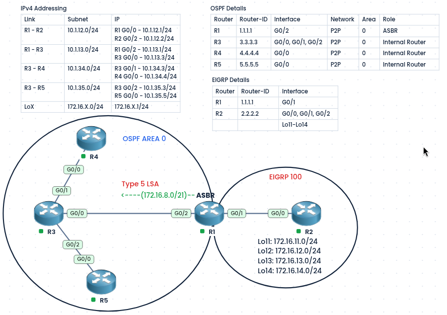
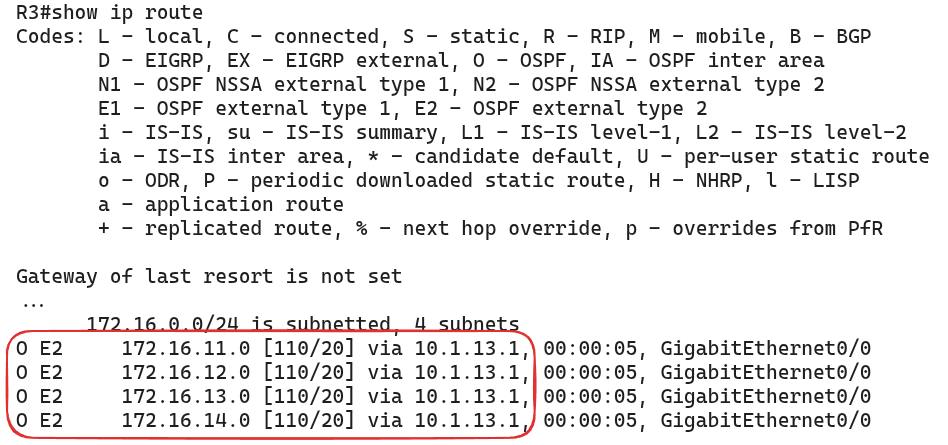
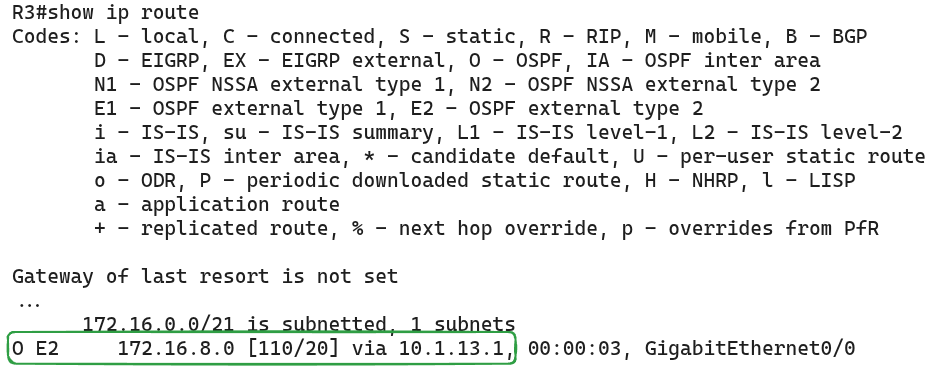
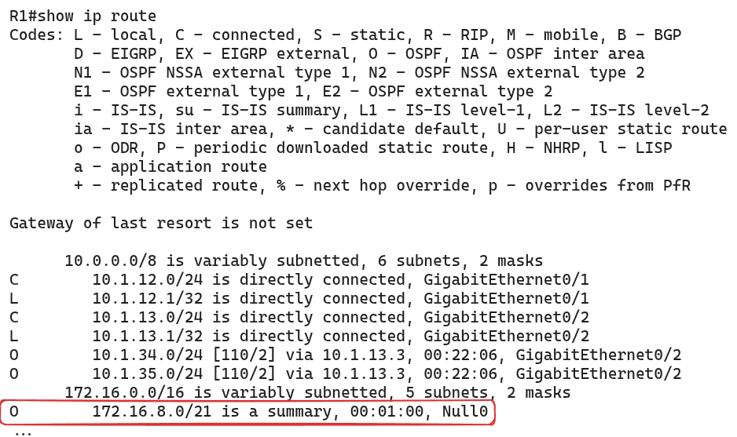
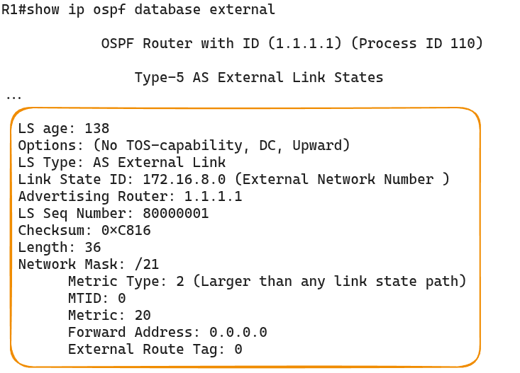
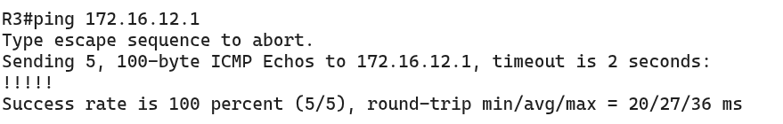
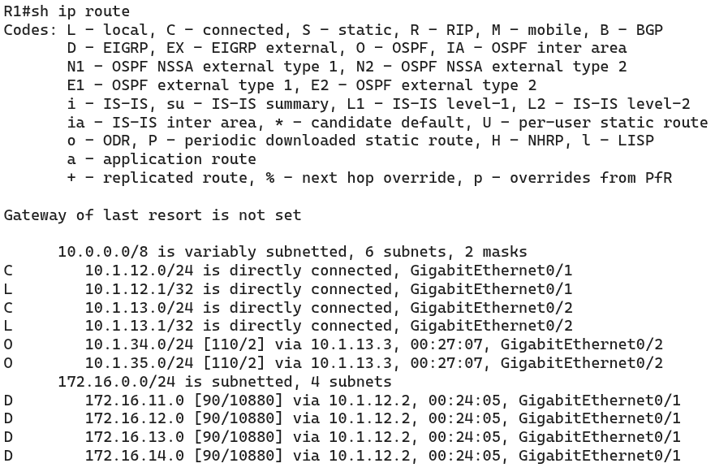
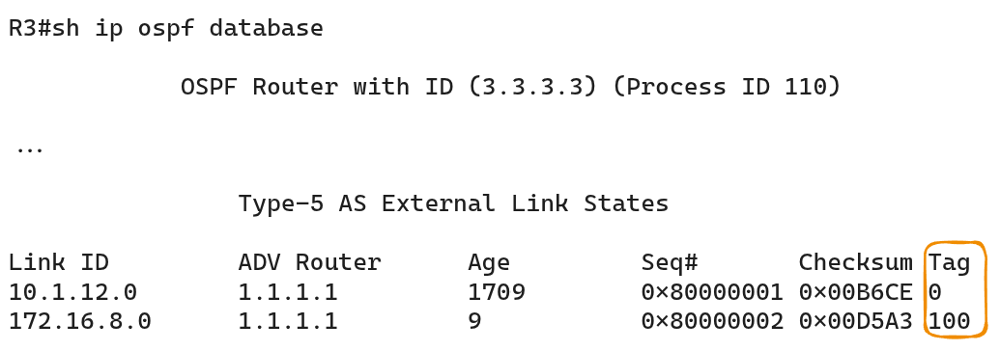
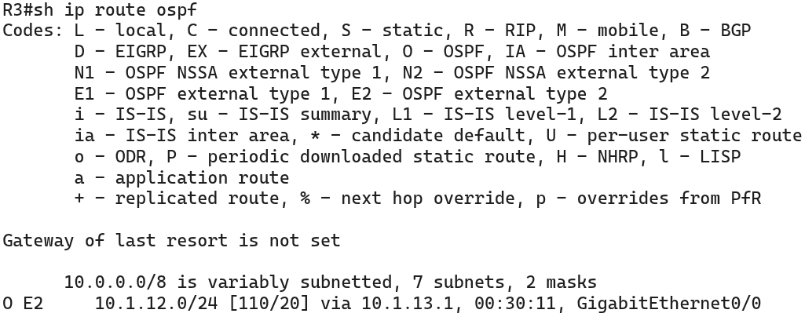

#### Labs built using:
- [PingMyNetwork Sandbox](https://pingmynetwork.com/profile/doer)
---
## OSPF External Route Summarization

#### 1). Topology Overview
- R1 is the **ASBR** (Autonomous System Boundary Router). It performs two-way multipoint redistribution
- R2 has four loopbacks (Lo11 to Lo14: `172.16.11.0/24` to `172.16.14.0/24`) are advertised into EIGRP.
- Without summarization, R1 advertises each loopback into OSPF Domain as its own **Type 5 LSA**, so R3, R4, and R5 each hold 4 separate routes.
- **Goal:** Summarize the four loopbacks into one route, `172.16.8.0/21`, on R1.
* Advantages of summarization:
	- Fewer routes in the routing tables.
	- Smaller LSDB, so less memory and CPU use.
	- Changes inside EIGRP domain (such as a loopback flapping) no longer cause updates in OSPF domain.
---
#### 2). IPv4 Addressing and OSPF Details
##### IPv4 Addressing

| Link    | Subnet        | IP                                               |
| ------- | ------------- | ------------------------------------------------ |
| R1 - R2 | 10.1.12.0/24  | R1 G0/0 - 10.1.12.1/24<br>R2 G0/2 - 10.1.12.2/24 |
| R1 - R3 | 10.1.13.0/24  | R1 G0/2 - 10.1.13.1/24<br>R3 G0/0 - 10.1.13.3/24 |
| R3 - R4 | 10.1.34.0/24  | R3 G0/1 - 10.1.34.3/24<br>R4 G0/0 - 10.1.34.4/24 |
| R3 - R5 | 10.1.35.0/24  | R3 G0/2 - 10.1.35.3/24<br>R5 G0/0 - 10.1.35.5/24 |
| LoX     | 172.16.X.0/24 | 172.16.X.1/24                                    |
##### OSPF Details

| Router | Router-ID | Interface        | Network | Area | Role            |
| ------ | --------- | ---------------- | ------- | ---- | --------------- |
| R1     | 1.1.1.1   | G0/2             | P2P     | 0    | ASBR            |
| R3     | 3.3.3.3   | G0/0, G0/1, G0/2 | P2P     | 0    | Internal Router |
| R4     | 4.4.4.4   | G0/0             | P2P     | 0    | Internal Router |
| R5     | 5.5.5.5   | G0/0             | P2P     | 0    | Internal Router |

---
#### 3). Finding the Summary Address
- Write the third octet of each network in binary and find the bits they share:

| Network     | Third octet (binary) |
| ----------- | -------------------- |
| 172.16.11.0 | 000010**11**         |
| 172.16.12.0 | 000011**00**         |
| 172.16.13.0 | 000011**01**         |
| 172.16.14.0 | 000011**10**         |

- The first 5 bits (`00001`) are the same in all four, so the summary is `172.16.00001000.0` = **`172.16.8.0/21`** (16 + 5 = 21 bits, mask `255.255.248.0`).

---
#### 4). Configuration
* Before summarization we need redistribute routes from OSPF domain into EIGRP domain (and vice-versa), so that R1 becomes ASBR
```
! R1
router ospf 110
 redistribute eigrp 100 subnets
router eigrp doer
 address-family ipv4 unicast autonomous-system 100
  topology-base
   redistribute ospf 110 metric 1 1 1 1 1
```
- External Route Summarization is done **on the ASBR**, using `summary-address <ip> <mask>`.
- R1:
```
router ospf 110
 summary-address 172.16.8.0 255.255.248.0
```
---
#### 5). Verification
* R3's routing table before summarization
* 
- On R3: `show ip route ospf` now shows one route `172.16.8.0/21` (marked `O E2`) instead of four.
- 
- On R1: `show ip route` shows a route to `172.16.8.0/21` via `Null0`. This is an automatic discard route that prevents routing loops.
- 
- On R1: `show ip ospf database external` shows a single Type 5 LSA for `172.16.8.0`.
- 
- Ping `172.16.12.1` from R3 to confirm reachability still works.
- 
---
#### 6). Other features
##### i). Incase if you want to remove the automatic Null0 discard route created by the ASBR summary:
```
! R1
router ospf 110
 no discard-route external
```
* Verify that the Null0 discard route is no longer present in R1's routing table.
* 
##### ii). Setting tags
```
! R1
router ospf 110
 summary-address 172.16.8.0 255.255.248.0 tag 100
```
* Check the tags in R3 OSPF database
* 
##### iii). Instead of summarizing the 172s prefix, if you want to filter those routes using summary address:
```
! R1
router ospf 110
 summary-address 172.16.8.0 255.255.248.0 not-advertise
```
* Check in R3 now, you won't receive any matching external for 172s subnet
* 