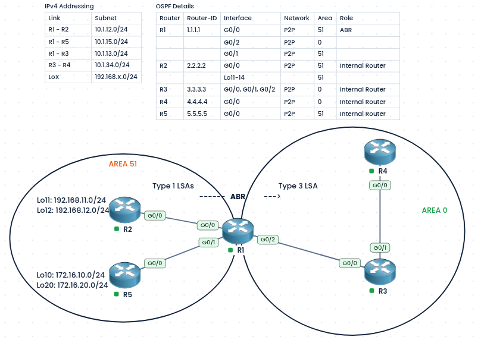
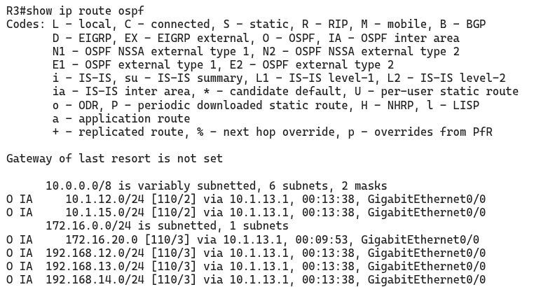
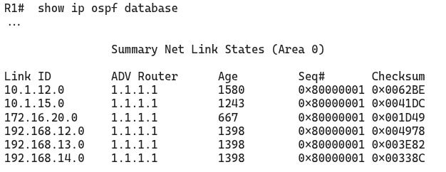

### Labs built using:
- [PingMyNetwork Sandbox](https://pingmynetwork.com/profile/doer)
---
## OSPF Filter-List: Filtering Type 3 LSAs on the ABR

#### 1). Topology Overview
- R1 is the **ABR**. It connects Area 51 (R2, R5) to Area 0 (R3, R4).
- R2 has `Lo11` (`192.168.11.0/24`) and `Lo12` (`192.168.12.0/24`), and R5 has `Lo10` (`172.16.10.0/24`) and `Lo20` (`172.16.20.0/24`). All of them are in Area 51.
- R1 turns each Area 51 route into a **Type 3 LSA** and floods it into Area 0, so R3 and R4 learn all four loopbacks.
- **Goal:** Area 0 must **not receive** the Type 3 LSAs for `192.168.11.0/24` (Lo11 on R2) and `172.16.10.0/24` (Lo10 on R5). All other Type 3 LSAs must still reach Area 0.
- The filter is applied on R1, because only an ABR can filter Type 3 LSAs.
---
#### 2). Base OSPF Configuration
- R2, R5, and the R1 links are set to `ospf network point-to-point`, and the loopbacks are enabled in Area 51 with `ip ospf 110 area 51`.
- - R1:
```
router ospf 110
 router-id 1.1.1.1

interface range G0/0-1
 ip ospf network point-to-point
 ip ospf 110 area 51

interface G0/2
 ip ospf network point-to-point
 ip ospf 110 area 0
```
- R2:
```
router ospf 110
 router-id 2.2.2.2

interface range Loopback11,Loopback12
 ip ospf network point-to-point
 ip ospf 110 area 51
 
interface G0/0
 ip ospf network point-to-point
 ip ospf 110 area 51
```
- R5:
```
router ospf 110
 router-id 5.5.5.5

interface range Loopback10,Loopback20
 ip ospf network point-to-point
 ip ospf 110 area 51

interface G0/0
 ip ospf network point-to-point
 ip ospf 110 area 51
```
- NOTE:
    - A loopback is advertised as a `/32` host route by default. To advertise it with its real `/24` mask, set `ip ospf network point-to-point` on the loopback, as done above.
    - Without it, the prefix list would have to match the `/32` addresses (`192.168.11.1/32` and `172.16.10.1/32`) instead of the `/24` networks.
- R3 and R4: plain OSPF in Area 0, with no special configuration.
---
#### 3). Configuration (Filter-List on R1)
- The prefix list **denies** the two prefixes and **permits** everything else. It is applied with `area 51 filter-list ... out` on R1.
- R1:
```
ip prefix-list pl-lo10-n-lo11 deny 192.168.11.0/24
ip prefix-list pl-lo10-n-lo11 deny 172.16.10.0/24
ip prefix-list pl-lo10-n-lo11 permit 0.0.0.0/0 le 32

router ospf 110
 area 51 filter-list prefix pl-lo10-n-lo11 out
```
- NOTE:
    - The prefix list ends with an implicit deny, so `permit 0.0.0.0/0 le 32` is needed to let all other Type 3 LSAs through.
    - The prefix list matches the exact prefix and length. This works because the loopbacks are set to point-to-point, so they are `/24`. If they were `/32`, the entries would need to be `192.168.11.1/32` and `172.16.10.1/32`.
---
#### 4). Verification
- On R3 and R4, `show ip route ospf` should **not** show `192.168.11.0/24` and `172.16.10.0/24`.
- 
- On R1, `show ip ospf database summary` should list Type 3 LSAs for the allowed prefixes only in Area 0.
- 
- On R2 and R5, all routes are still present, because the filter affects only Area 0.