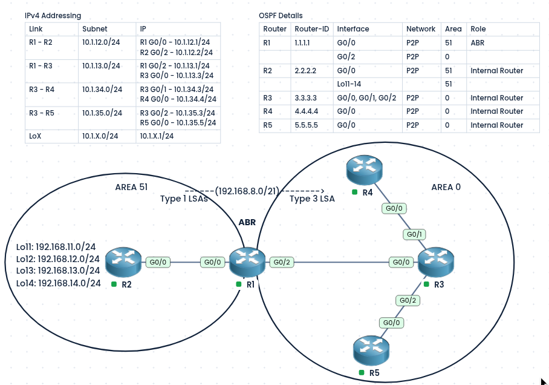
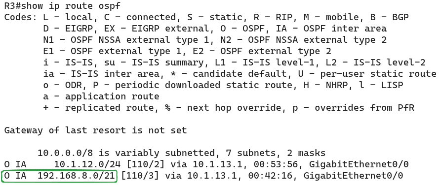
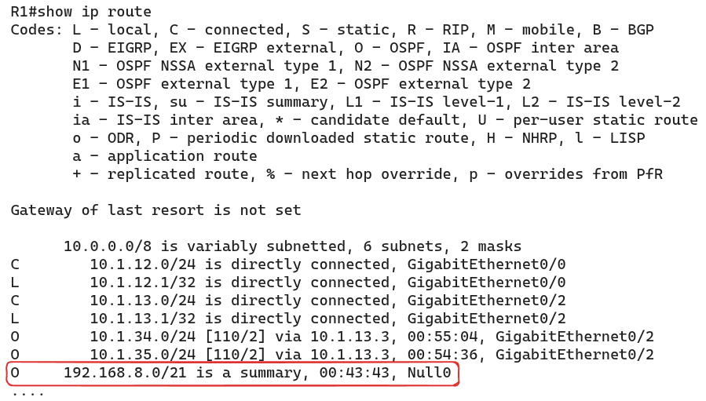
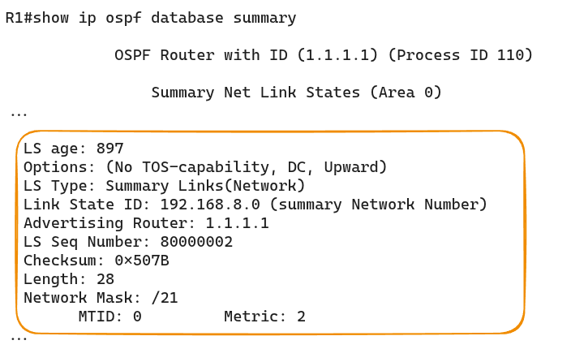
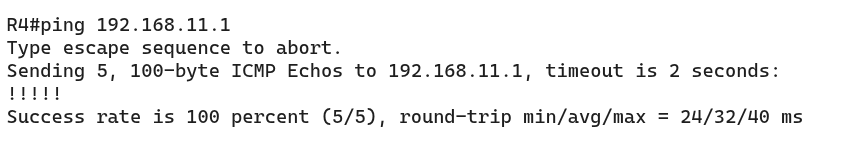
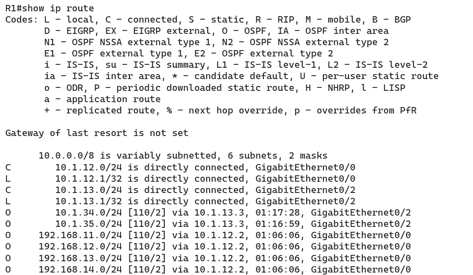
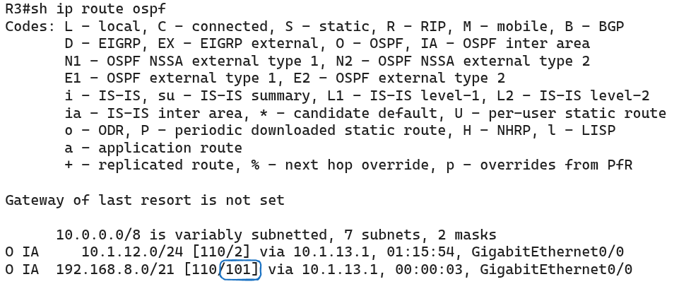
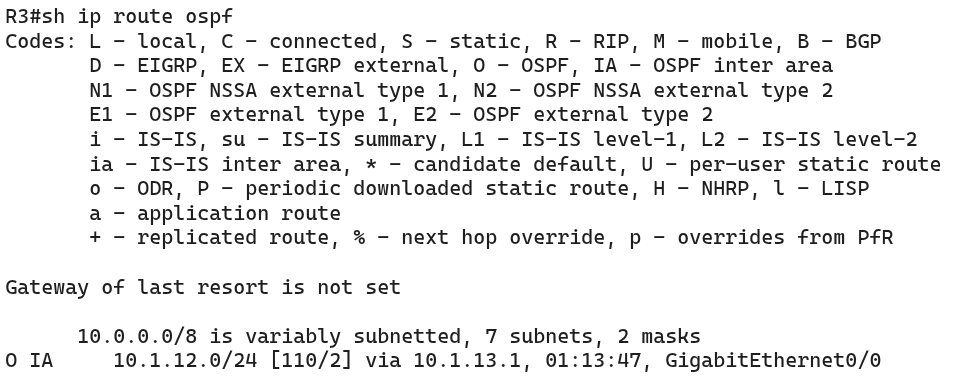

#### Labs built using:
- [PingMyNetwork Sandbox](https://pingmynetwork.com/profile/doer)
---
## OSPF Inter-Area Summarization

#### 1). Topology Overview
- R1 is the **ABR** (Area Border Router). It connects Area 51 (R2) to Area 0 (R3, R4, R5).
- R2 has four loopbacks (Lo11 to Lo14: `192.168.11.0/24` to `192.168.14.0/24`) in Area 51.
- Without summarization, R1 sends each loopback into Area 0 as its own **Type 3 LSA**, so R3, R4, and R5 each hold 4 separate routes.
- **Goal:** Summarize the four loopbacks into one route, `192.168.8.0/21`, on R1.
* Advantages of summarization:
	- Fewer routes in the routing tables of Area 0.
	- Smaller LSDB, so less memory and CPU use.
	- Changes inside Area 51 (such as a loopback flapping) no longer cause updates in Area 0.
---
#### 2). IPv4 Addressing and OSPF Details
##### IPv4 Addressing

| Link    | Subnet       | IP                                               |
| ------- | ------------ | ------------------------------------------------ |
| R1 - R2 | 10.1.12.0/24 | R1 G0/0 - 10.1.12.1/24<br>R2 G0/2 - 10.1.12.2/24 |
| R1 - R3 | 10.1.13.0/24 | R1 G0/2 - 10.1.13.1/24<br>R3 G0/0 - 10.1.13.3/24 |
| R3 - R4 | 10.1.34.0/24 | R3 G0/1 - 10.1.34.3/24<br>R4 G0/0 - 10.1.34.4/24 |
| R3 - R5 | 10.1.35.0/24 | R3 G0/2 - 10.1.35.3/24<br>R5 G0/0 - 10.1.35.5/24 |
| LoX     | 10.1.X.0/24  | 10.1.X.1/24                                      |
##### OSPF Details

| Router | Router-ID | Interface        | Network | Area | Role            |
| ------ | --------- | ---------------- | ------- | ---- | --------------- |
| R1     | 1.1.1.1   | G0/0             | P2P     | 51   | ABR             |
|        |           | G0/2             |         | 0    |                 |
| R2     | 2.2.2.2   | G0/0             | P2P     | 51   | Internal Router |
|        |           | Lo11-14          |         | 51   |                 |
| R3     | 3.3.3.3   | G0/0, G0/1, G0/2 | P2P     | 0    | Internal Router |
| R4     | 4.4.4.4   | G0/0             | P2P     | 0    | Internal Router |
| R5     | 5.5.5.5   | G0/0             | P2P     | 0    | Internal Router |

---
#### 3). Finding the Summary Address
- Write the third octet of each network in binary and find the bits they share:

|Network|Third octet (binary)|
|---|---|
|192.168.11.0|000010**11**|
|192.168.12.0|000011**00**|
|192.168.13.0|000011**01**|
|192.168.14.0|000011**10**|

- The first 5 bits (`00001`) are the same in all four, so the summary is `192.168.00001000.0` = **`192.168.8.0/21`** (16 + 5 = 21 bits, mask `255.255.248.0`).

---
#### 4). Configuration
- Summarization is done **on the ABR**, using `area <area-id> range`. The area ID is the area where the routes **come from** (Area 51).
- R1:
```
router ospf 110
 area 51 range 192.168.8.0 255.255.248.0
```
---
#### 5). Verification
- On R3: `show ip route ospf` now shows one route `192.168.8.0/21` (marked `O IA`) instead of four.
- 
- On R1: `show ip route` shows a route to `192.168.8.0/21` via `Null0`. This is an automatic discard route that prevents routing loops.
- 
- On R1: `show ip ospf database summary` shows a single Type 3 LSA for `192.168.8.0`.
- 
- Ping `192.168.11.1` from R4 to confirm reachability still works.
- 
---
#### 6). Other features
##### i). Incase if you want to remove the automatic Null0 discard route created by the ABR summary:
```
! R1
router ospf 110
 no discard-route internal
```
* Check R1 Routing Table no more route toward `Null0`
* 
##### ii). IOS XE routers set the default metric for the summary LSA to be the lowest metric associated with an LSA, to set it statically
```
! R1
router ospf 110
 area 51 range 192.168.8.0 255.255.248.0 cost 100
```
* Check in R1
* 
##### iii). Instead of summarizing the 192s prefix, if you want to filter those routes using summary address:
```
! R1
router ospf 110
 area 51 range 192.168.8.0 255.255.248.0 not-advertise
```
* Check in R1 now, you won't receive an single prefix from 192s subnet
* 