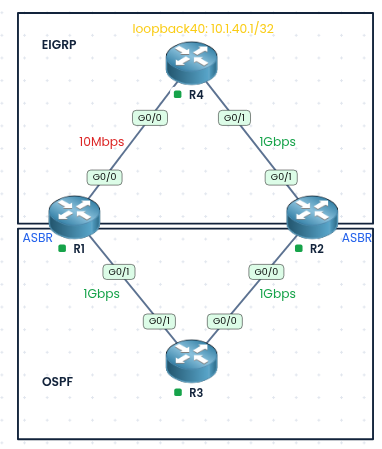
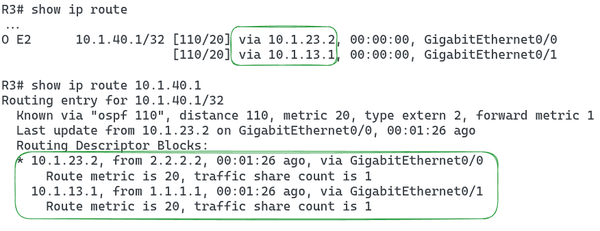
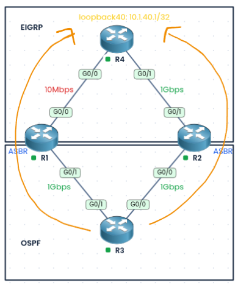
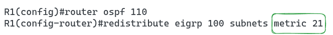
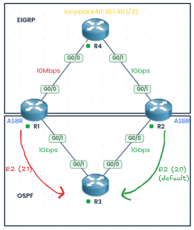
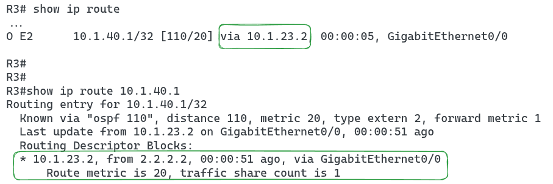
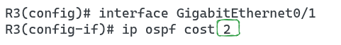
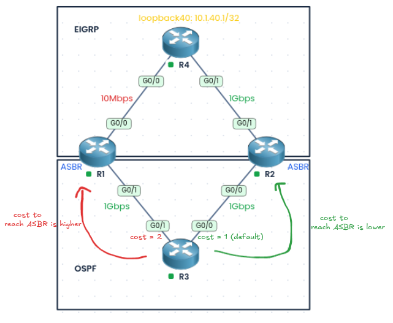
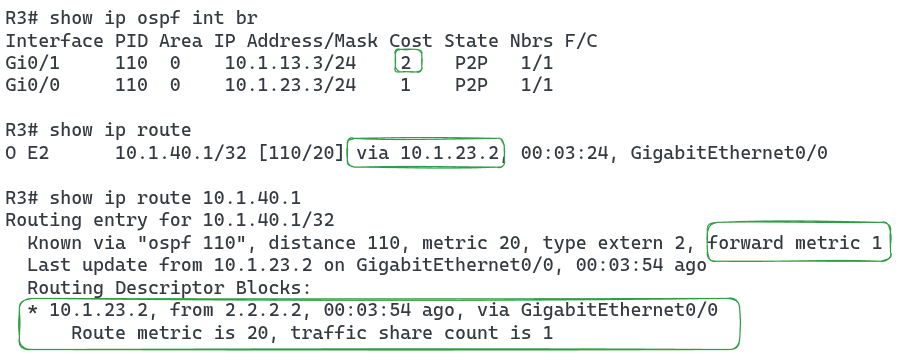

### Labs built using:
* [PingMyNetwork Sandbox](https://pingmynetwork.com/)
---
# OSPF Suboptimal Routing

##### i). Topology Overview
- In the following topology:
	- R4 is running EIGRP
	- R3 is running OSPF
	- R1 and R2 is running both EIGRP and OSPF
	- `Loopback40` on R4 (`10.1.40.1/32`) is advertised in EIGRP, so both R1 and R2 have this prefix in their routing tables
	- R1 and R2 both redistribute EIGRP into OSPF using the default metric type (`E2`)
##### ii). Goal
- R3 should reach R4’s `Loopback40` (`10.1.40.1/32`) through **R2**, because the link between R1 and R4 is only 10 Mbps.
##### iii). Inspecting R3
* Check the routing table on R3:
* 
* Result:
	* R3 is load balancing traffic across R1 and R2. This is not what we want, because part of the traffic goes through the slow 10 Mbps link too.
	* 
* Why it happens:
	* Both R1 and R2 advertise the prefix as `E2` with the same metric (20), and the cost to reach each of them from R3 is the same. With everything equal, R3 uses both paths
##### iv). Solution 1
* Make R1’s external route less attractive by giving it a higher E2 metric than R2’s default (20). R3 will then choose the route with the lower metric, which is R2’s
* 
* 
* Verify on R3
* 
* R3 now uses only the path through R2
###### v). Solution 2
* Increase the OSPF cost on the R3 interface that connects to R1. This makes the forward metric (the cost to reach the ASBR) higher for R1 than for R2, so R3 prefers R2
* 
* 
* Verify on R3
* 