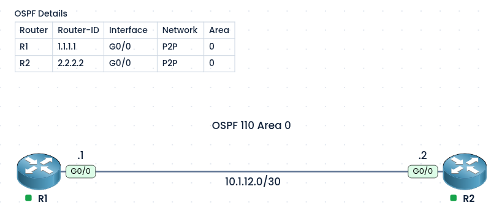
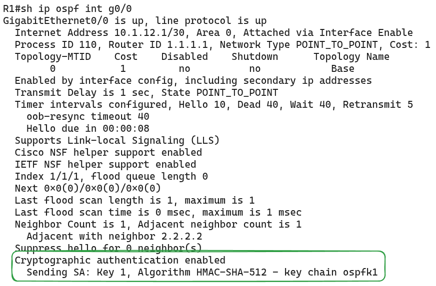
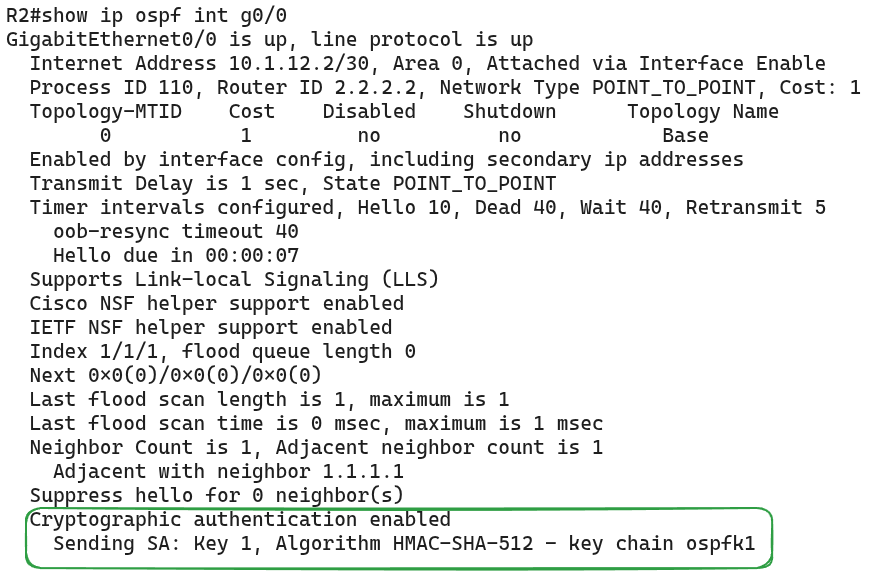

#### Labs built using:
- [PingMyNetwork Sandbox](https://pingmynetwork.com/profile/doer)
---
## OSPFv2 Authentication

#### 1). Topology Overview
- R1 and R2 are connected point-to-point over `10.1.12.0/30`, and each interface is enabled in OSPF 110 Area 0.
---
#### 2). Theory
* Authentication Type in OSPF

| Type | Name            | Description                       |
| ---- | --------------- | --------------------------------- |
| 0    | NULL            | No authentication (default)       |
| 1    | Simple password | Plain-text password               |
| 2    | Cryptographic   | MD5, or HMAC-SHA with a key chain |

---
#### 3). Configuration (Type 1)
* Maximum of 8 characters, sent in plain text
```
! R1
interface Gi0/0
 ip ospf authentication-key cisco123
 ip ospf authentication

! R2
interface Gi0/0
 ip ospf authentication-key cisco123
 ip ospf authentication
```
* NOTE:
	* The password is visible in `show run` and in a packet capture, so it is not recommended outside labs.
---
#### 4). Configuration (Type 2) - Using MD5
```
! R1
interface Gi0/0
 ip ospf message-digest-key 1 md5 cisco@123
 ip ospf authentication message-digest

! R2
interface Gi0/0
 ip ospf message-digest-key 1 md5 cisco@123
 ip ospf authentication message-digest
```
* NOTE:
	* Key ID `1` must match on both sides, as must the password
	* `show run` shows the key in plain text. It is encrypted only if `service password-encryption` is configured.
---
#### 5). Configuration (Type 2) - HMAC SHA with Key Rotation

| Key Number | Key String | Algorithm    | Send (From) | Send (To)   | Accept (From) | Accept (To) |
| ---------- | ---------- | ------------ | ----------- | ----------- | ------------- | ----------- |
| 1          | Cisc0@1112 | hmac-sha-512 | 20 Oct 2026 | 20 Nov 2026 | 20 Oct 2026   | 21 Nov 2026 |
| 2          | D1sco@2123 | hmac-sha-512 | 20 Nov 2026 | 20 Dec 2026 | 19 Nov 2026   | 21 Dec 2026 |
* NOTE:
	* The accept window is wider than the send window, so a small clock difference between R1 and R2 at the changeover does not break the neighbor.
	- Both routers should use NTP, since the key rotation depends on the time.
```
! R1
key chain ospfk1
 key 1
  key-string Cisc0@1112
  cryptographic-algorithm hmac-sha-512
  accept-lifetime local 00:00:00 20 Oct 2026 00:00:00 21 Nov 2026
  send-lifetime local 00:00:00 20 Oct 2026 00:00:00 20 Nov 2026
  exit
 key 2
  key-string D1sco@2123
  cryptographic-algorithm hmac-sha-512
  accept-lifetime local 00:00:00 19 Nov 2026 00:00:00 21 Dec 2026
  send-lifetime local 00:00:00 20 Nov 2026 00:00:00 20 Dec 2026
  exit

interface Gi0/0
 ip ospf authentication key-chain ospfk1
 
! R2
key chain ospfk1
 key 1
  key-string Cisc0@1112
  cryptographic-algorithm hmac-sha-512
  accept-lifetime local 00:00:00 20 Oct 2026 00:00:00 21 Nov 2026
  send-lifetime local 00:00:00 20 Oct 2026 00:00:00 20 Nov 2026
  exit
 key 2
  key-string D1sco@2123
  cryptographic-algorithm hmac-sha-512
  accept-lifetime local 00:00:00 19 Nov 2026 00:00:00 21 Dec 2026
  send-lifetime local 00:00:00 20 Nov 2026 00:00:00 20 Dec 2026
  exit

interface Gi0/0
 ip ospf authentication key-chain ospfk1
```
---
#### 6). Verification
* R1
* 
* R2
* 
* To check the debugs messages run:
```
! enable
debug ip ospf adj

! disable
undebug all
```