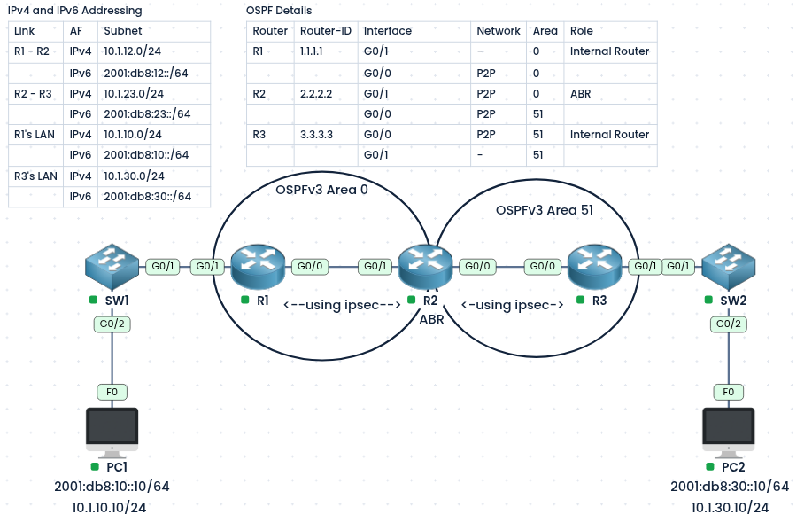
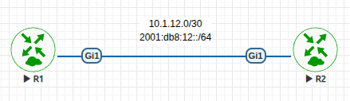
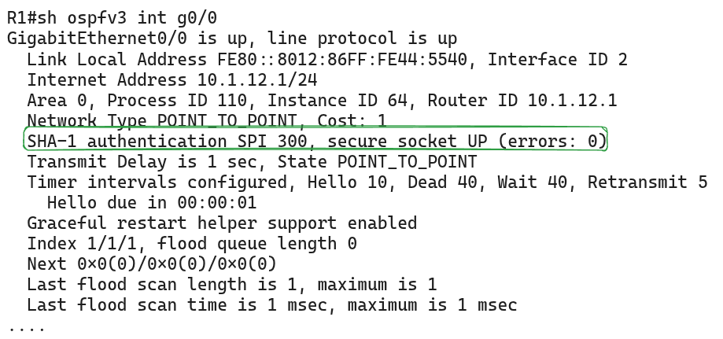

#### Labs built using:
- [PingMyNetwork Sandbox](https://pingmynetwork.com/profile/doer)
---
## OSPFv3 Authentication using IPSec and Key-Chain

#### 1). Topology Overview
- This lab uses the same topology, IP addressing, and OSPFv3 configuration as the previous lab: [OSPFv3 Dual-Stack](https://github.com/doer08736/network-labs/tree/master/ospfv3-dual-stack). Refer to it for the details.
- Authentication is added on the router links, using a different method depending on the router image:
	- **PingMyNetwork Sandbox (R1, R2, R3):** IPsec authentication on both links, **R1 - R2 (Area 0)** and **R2 - R3 (Area 51)**. The sandbox does not support key-chain authentication.
	- **Cisco IOS XE router (separate topology):** a small R1 - R2 topology is used to show IPsec (with the license enabled) and key-chain authentication.
- **Goal:** The routers keep their OSPFv3 neighbors only with authenticated peers, for both IPv4 and IPv6.
---
#### 2). Theory
- OSPFv3 has no built-in authentication fields in its packets, unlike OSPFv2. It relies on two other methods:
    - **IPsec (AH or ESP):** the original method (RFC 4552). OSPFv3 packets are protected by an IPsec header, which gives authentication (and encryption with ESP).
    - **Authentication trailer (key-chain):** the newer method (RFC 7166). A trailer is added to each OSPFv3 packet, and the keys come from a key chain, so keys can be rotated with lifetimes.
- **IPsec authentication:**
    - Each side is configured with the same **SPI** (a number that identifies the security association) and the same **key**.
    - The packets carry a hash (SHA-1 here) that proves they came from a trusted router and were not changed.
    - If the SPI, algorithm, or key differs, the neighbor will not form.
- The SPI and key must match on both ends of the link.
- IPsec does not support key rotation with lifetimes, while the key-chain method does.
---
#### 3). Configuration (IPsec) - R1 to R2 to R3
- The SPI (`300`) and the 40-character hex key must be the same on both routers.
- The SHA-1 key must be exactly 40 hex characters (`0-9`, `a-f`).
##### Option A: PingMyNetwork Sandbox router
- This sandbox image only accepts the classic `ipv6 ospf authentication ipsec ...` command. The newer `ospfv3 authentication ...` form is not available in its interface menu.
```
! R1
interface Gi0/0
 ipv6 ospf authentication ipsec spi 300 sha1 a1b2c3d4e5f60718293a4b5c6d7e8f9012345678

! R2
interface range Gi0/0-1
 ipv6 ospf authentication ipsec spi 300 sha1 a1b2c3d4e5f60718293a4b5c6d7e8f9012345678
 
! R3
interface range Gi0/0
 ipv6 ospf authentication ipsec spi 300 sha1 a1b2c3d4e5f60718293a4b5c6d7e8f9012345678
```
- Even though you enter the classic command, IOS converts it, and `show run` displays it in the newer `ospfv3` form:
```
R1#show run interface Gi0/0
 ...
 ospfv3 authentication ipsec spi 300 sha1 a1b2c3d4e5f60718293a4b5c6d7e8f9012345678
 ...
```
- NOTE:
    - The converted `ospfv3 authentication` line is only for display. You cannot type it manually on this image.
##### Option B: Cisco IOS XE 17.x

- **IMPORTANT NOTE:** If the `ipsec` keyword does not appear after typing `ipv6 ospf authentication ?` or `ospfv3 authentication ?`, enable the license level below on R1 and R2. A reload is required for it to take effect.
```
! R1, R2
configure terminal
 license boot level network-advantage addon dna-advantage
 end
write memory
reload
```
- After the reload, configure authentication. Either command form works (the `ospfv3` form is shown, and the classic form is in the comment):
```
! R1
interface Gi1
 ospfv3 authentication ipsec spi 300 sha1 a1b2c3d4e5f60718293a4b5c6d7e8f9012345678
 ! or: ipv6 ospf authentication ipsec spi 300 sha1 a1b2c3d4e5f60718293a4b5c6d7e8f9012345678

! R2
interface Gi1
 ospfv3 authentication ipsec spi 300 sha1 a1b2c3d4e5f60718293a4b5c6d7e8f9012345678
 ! or: ipv6 ospf authentication ipsec spi 300 sha1 a1b2c3d4e5f60718293a4b5c6d7e8f9012345678
```
---
#### 4). Configuration (Key-Chain) - R1 to R2
* NOTE: Key-Chain Authentication for IPv6 currently not support in PingMyNetwork Sandbox
* Below is the configuration in Cisco IOS XE Router
* 
```
! R1
key chain ospfv3k1
 key 1
  key-string Cisc0@1112
  cryptographic-algorithm hmac-sha-256

interface Gi0/0
 ospfv3 authentication key-chain ospfv3k1

! R2
key chain ospfv3k1
 key 1
  key-string Cisc0@1112
  cryptographic-algorithm hmac-sha-256

interface Gi0/0
 ospfv3 authentication key-chain ospfv3k1
```
- NOTE:
    - The key ID, key string, and algorithm must match on both routers.
    - Key rotation (`send-lifetime` and `accept-lifetime`) is not configured in this lab, so the single key stays valid at all times. To add rotation, see the OSPFv2 lab: [OSPFv2 Authentication](https://github.com/doer08736/network-labs/tree/master/ospfv2-authentication)
---
#### 5). Verification
* R1
* 