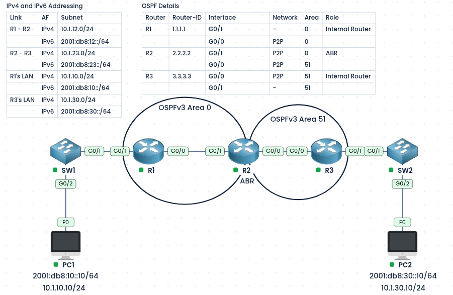
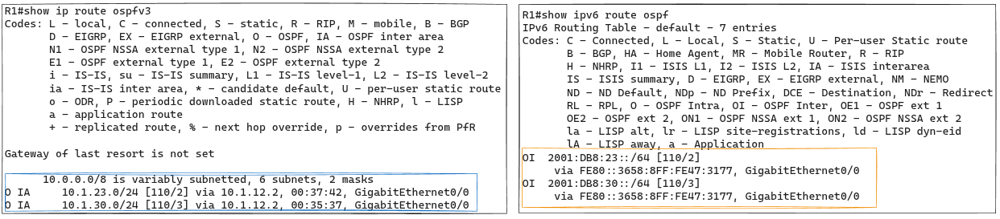
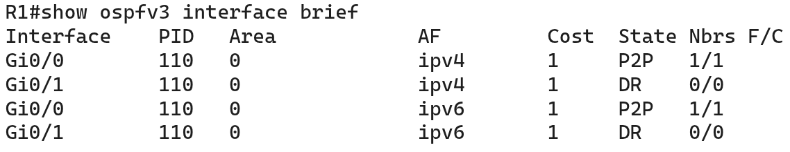
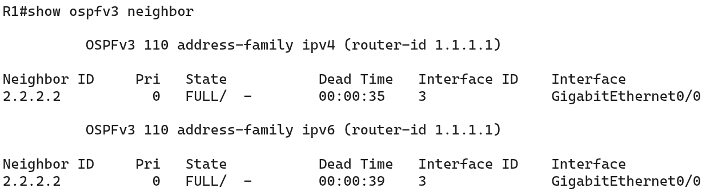
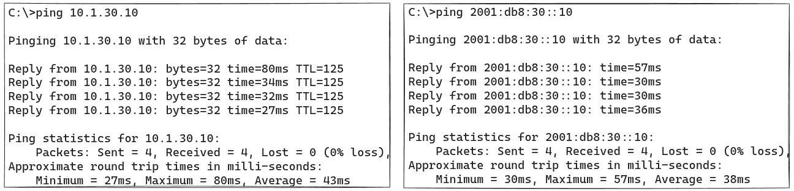

#### Labs built using:
- [PingMyNetwork Sandbox](https://pingmynetwork.com/profile/doer)
---
## OSPFv3 Dual Stack (IPv4 and IPv6)

#### 1). Topology Overview
- R1, R2, and R3 are connected point-to-point, and every interface runs **dual stack** (both IPv4 and IPv6 addresses on the same interface).
- R1’s LAN (`10.1.10.0/24` and `2001:db8:10::/64`) is behind R1, and R3’s LAN (`10.1.30.0/24` and `2001:db8:30::/64`) is behind R3.
- PC1 and PC2 each have an IPv4 and an IPv6 address (dual stack).
- **Goal:**
	- PC1 and PC2 can reach each other over both IPv4 and IPv6.
- R1, R2, and R3 run OSPFv3 with one process (`110`) that carries both IPv4 and IPv6 routes, using address families.
- R2 is the ABR, connecting Area 0 (R1) to Area 51 (R3).
---
#### 2). NOTEs
* Requires Cisco IOS version 15.1(3)S or 15.2(1)T or higher
* OSPFv2 supports only IPv4. OSPFv3 was built for IPv6, and with address families it can also carry IPv4. OSPFv3 and OSPFv2 cannot form neighbors with each other.
* Each address family runs as its own instance, with its own neighbors and LSDB.
---
#### 3). IPv4 and IPv6 Addressing and OSPF Details
##### IPv4 and IPv6 Addressing

| Link     | AF   | Subnet           |
| -------- | ---- | ---------------- |
| R1 - R2  | IPv4 | 10.1.12.0/24     |
|          | IPv6 | 2001:db8:12::/64 |
| R2 - R3  | IPv4 | 10.1.23.0/24     |
|          | IPv6 | 2001:db8:23::/64 |
| R1's LAN | IPv4 | 10.1.10.0/24     |
|          | IPv6 | 2001:db8:10::/64 |
| R3's LAN | IPv4 | 10.1.30.0/24     |
|          | IPv6 | 2001:db8:30::/64 |
##### OSPF Details

| Router | Router-ID | Interface | Network | Area | Role            |
| ------ | --------- | --------- | ------- | ---- | --------------- |
| R1     | 1.1.1.1   | G0/1      | -       | 0    | Internal Router |
|        |           | G0/0      | P2P     | 0    |                 |
| R2     | 2.2.2.2   | G0/1      | P2P     | 0    | ABR             |
|        |           | G0/0      | P2P     | 51   |                 |
| R3     | 3.3.3.3   | G0/0      | P2P     | 51   | Internal Router |
|        |           | G0/1      | -       | 51   |                 |

---
#### 4). Configuration
##### Step 1: IPv6 Routing must be enabled on every router.
```
! R1, R2, R3
ipv6 unicast-routing
```
##### Step 2: Enable OSPF in R1, R2, R3
* NOTE:
	* `passive-interface default` is used on R1 and R3, and only the link toward R2 (`Gi0/0`) is made active. The LAN interfaces stay passive, but their networks are still advertised.
	* `ospfv3 network point-to-point` is set on the router links, so no DR/BDR election is done.
- R1:
```
router ospfv3 110
 router-id 1.1.1.1
 passive-interface default
 no passive-interface G0/0

interface G0/0
 ospfv3 network point-to-point
 ospfv3 110 ipv4 area 0
 ospfv3 110 ipv6 area 0

interface G0/1
 ospfv3 110 ipv4 area 0
 ospfv3 110 ipv6 area 0
```
- R2 (ABR):
```
router ospfv3 110
 router-id 2.2.2.2

interface G0/1
 ospfv3 network point-to-point
 ospfv3 110 ipv4 area 0
 ospfv3 110 ipv6 area 0

interface G0/0
 ospfv3 network point-to-point
 ospfv3 110 ipv4 area 51
 ospfv3 110 ipv6 area 51
```
- R3:
```
router ospfv3 110
 router-id 3.3.3.3
 passive-interface default
 no passive-interface G0/0

interface G0/0
 ospfv3 network point-to-point
 ospfv3 110 ipv4 area 51
 ospfv3 110 ipv6 area 51

interface G0/1
 ospfv3 110 ipv4 area 51
 ospfv3 110 ipv6 area 51
```
- NOTE:
    - R2 has no passive interfaces, because both of its interfaces are router links.
    - Each interface needs two `ospfv3` lines, one per address family.
---
#### 5). Verification
* Verifying IPv4 and IPv6 OSPF routes in the routing table
	*  Inter-area routes appear with the `OI` code (IPv6) or `O IA` (IPv4). For example, R1 learns `10.1.30.0/24` and `2001:db8:30::/64` from R2.
	* 
* Verifying the interfaces advertised in OSPFv3
* 
- The command below lists the neighbors twice per link (once for IPv4, once for IPv6), both in `FULL` state.
- 
* Test with pings from PC1 to PC2 (`ping 10.1.30.10` and `ping 2001:db8:30::10`):
* 
* Other useful commands
```
show ospfv3
show ospfv3 ipv4
show ospfv3 ipv6
show ospfv3 ipv4 neighbor
show ospfv3 ipv6 neighbor
show ospfv3 ipv4 interface
show ospfv3 ipv6 interface
show ospfv3 ipv4 database
show ospfv3 ipv6 database
```
---
#### 6). Shortcomings of OSPFv3
- It uses IPv6 as its transport, so IPv6 must work on every link, even for IPv4 routes
- Not backward compatible with OSPFv2, so the two cannot form neighbors
- Moving to OSPFv3 means changing the whole OSPF domain, and mergers and acquisitions can cause migration problems and need a big network change